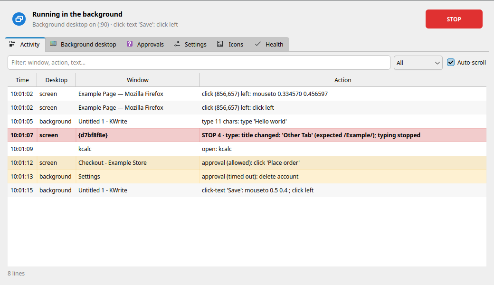
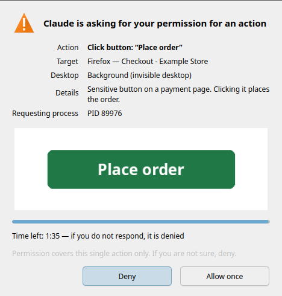
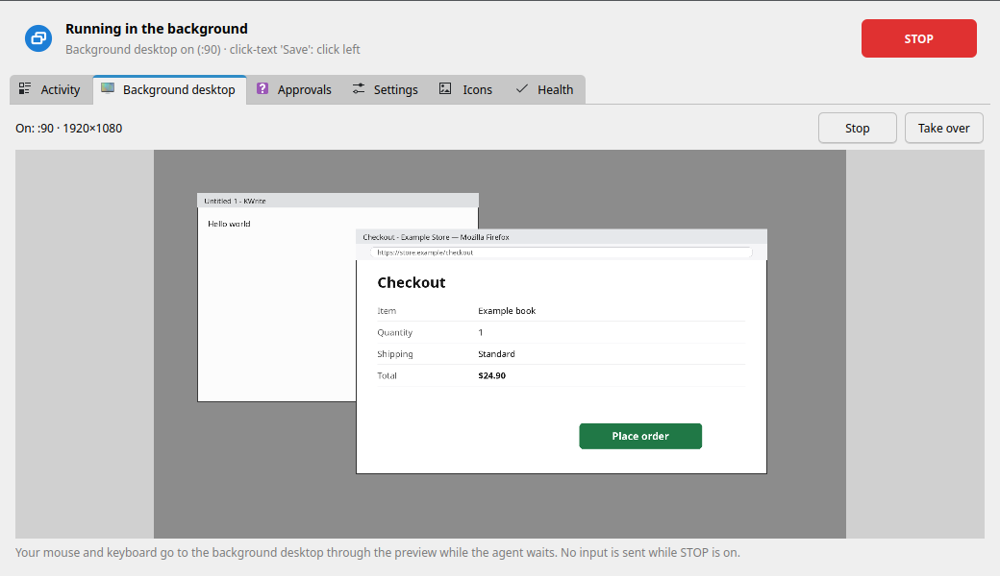

# Deskhand — let AI agents use your KDE desktop, safely

*Türkçe: [README.tr.md](README.tr.md)*

**Deskhand lets AI agents (Claude Code and other MCP clients) use your KDE Plasma desktop
safely — on your screen, or on an invisible second desktop while you watch a movie.**

An agent can read windows, click on visible text, type and open apps. Every input is checked
against what is actually on screen at that moment. Buy/Pay buttons and payment pages wait
for **your** answer in a dialog the agent cannot reach. It stops the moment you touch the
mouse, and one click on **STOP** halts everything. When you are busy, the work moves to a
hidden desktop that can reuse some of your logged-in sessions, so your film or game is never
interrupted.

It is a safety layer for well-meaning agents, not a sandbox (see [Threat model](#threat-model)).

<p align="center">
  
  
</p>
<p align="center">
  
  
</p>

<sub>Screenshots are rendered from sample data. The panel's language is Turkish for now;
an English UI is planned.</sub>

## Features

### Safety layers

These are enforced in the tool itself, on both desktops, whatever the agent or its
permission mode says:

- **Forbidden windows.** Windows whose title or class matches a pattern in
  `~/.config/deskhand/yasak-pencereler.txt` never receive input, and their apps are never
  started (for example an online game whose rules forbid automation, or a password manager).
  Over MCP they are also blacked out in screenshots and left out of OCR.
- **Sensitive buttons and payment pages need a human.** Buy, Pay, Place order, Authorize,
  Allow, Delete account (Turkish and English wording) and any click or Enter on a page whose
  title looks like checkout/payment trigger an **approval dialog in the Deskhand panel**:
  *Allow once* or *Deny*, with a small picture of the target. Only the panel can write the
  answer; the dialog itself is a forbidden window, so the agent cannot click it. No answer,
  timeout or panel not running = denied.
- **Window/tab title lock.** With `-b PATTERN` (CLI) or a window pattern (MCP) the title is
  re-checked right before every input. If a browser switched tabs, typing stops mid-word.
- **Human priority.** If you are using the mouse or keyboard (Wayland idle notification, no
  extra permissions), Deskhand waits for 1.5 s of quiet, up to 8 s, then gives up. Keys it
  is holding are released as soon as you touch anything.
- **STOP switch.** Panel button, tray menu or an optional global shortcut. While it is on,
  nothing sends input and held keys are released. An agent may set STOP itself, but **it
  cannot lift a STOP that you set**; only the panel can.
- **Activity log.** Every input is logged (`~/.local/state/deskhand`, kept 7 days) and shown
  live in the panel.

### Background desktop

`deskhand desktop start` starts an invisible desktop: Xvfb + openbox, 1920×1080 by
default, separate from your session.

- **Nothing reaches you.** No input goes to your screen (the background backend can only
  talk to its own X display). Apps there get a private D-Bus, so their notifications are
  captured to a log instead of popping up, and their audio goes to a silent sink.
  Wayland variables are removed so an app cannot escape to your screen.
- **Light.** Low CPU/IO priority and a memory cap (systemd scope, 4 GB by default).
  Starting it takes about 0.2 s; an empty desktop uses about 30 MiB.
- **Per-app session policy.** Some apps can open there already logged in:
  - **Firefox:** a consistent, **one-way snapshot copy** of your profile (cookies, logins,
    site storage for the task's sites). Nothing is ever written back. Sync identity is left out;
    cookies **and saved passwords** of banking/payment/government sites (including Turkish banks and
    e-Devlet) and central login pages (Google, Microsoft) are not copied, so Google/YouTube are not signed
    in there. Camera, microphone, location and notification permissions are removed from the copy.
  - **Flatpak apps that do not use the keyring** (for example Discord, Spotify): snapshot copy.
  - **Apps that need the keyring** (Chromium family, VS Code) and apps that write to real
    files (Obsidian vaults) run **only on your screen**.
  - **Apps that break with two clients** (Telegram, Signal, WhatsApp wrappers, Element,
    Steam, Thunderbird and similar) are **never cloned** and never started in the
    background: the agent is told to wait for you. Mail/sync daemons (KMail/Akonadi,
    Nextcloud) are never started either.
  - The policy is matched on the resolved app (desktop entry, executable, Flatpak id), so a different
    name or path cannot bypass it; the strictest match wins. Password managers are never started.
  - Unknown apps start normally only when they are **certainly not running** for you (otherwise their
    single-instance lock could open the window on your screen); if that cannot be known, the agent
    waits. Policy file: `~/.config/deskhand/oturum.toml`.
- **Watch and take over.** The panel shows a live preview. *Take over* sends your mouse and
  keyboard into the background desktop while the agent waits.

### Busy detection: "Background / My screen / Later"

`deskhand busy` checks, read-only, whether you are busy: a fullscreen window, a playing
media player (MPRIS), recent keyboard/mouse input, a game or forbidden window, a locked screen.

`deskhand decide "task summary"` turns that into a decision. If you are not busy, the answer
is *my screen*. If you are, by default a notification asks **Background / My screen / Later**
(no answer in 45 s = background). Over a fullscreen film or game it does not interrupt you
at all and goes straight to the background. All of this is configurable in the panel.

### Clicking by text (OCR first)

Agents click on **what they can read**, not on guessed coordinates: `click-text <window> "Save"`.
Tesseract reads Turkish and English. Turkish letters are matched loosely (ş/s, ı/i…) and an
ambiguous match stops instead of guessing. Also available: the accessibility tree (AT-SPI,
click by button name), saved icon templates, colour areas, and screen-recognition *flows*
for repetitive tasks.

### MCP server (12 tools)

`deskhand mcp` is a stdio MCP server: `get_status`, `choose_desktop`, `manage_desktop`,
`screenshot`, `read_text`, `find`, `click`, `type_text`, `press_key`, `scroll`, `open_app`,
`run_flow`. Screenshots are scaled to 1280 px on the long edge. Coordinates are checked
against a `shot_id`, so a click on a stale screenshot is refused. There is no "approved" flag
on the MCP surface: sensitive actions always go through the panel.

### Monitoring panel and tray

Activity (live log, filter), background desktop (preview, stop, take over), approvals
(pending + history), settings (busy behaviour, forbidden windows, STOP shortcut), saved icons
and a health check of all dependencies. The tray icon shows idle / on your screen / in the
background / STOP, with a badge when an approval is waiting.

## How it compares

There are good projects in this space; pick what fits you.

- [agent-sh/agent-workspace-linux](https://github.com/agent-sh/agent-workspace-linux) is the
  closest: a hidden desktop on six backends (including a native KWin Wayland virtual
  compositor), keyring and Chrome profile import, app allow-list, a live viewer, 82 tools.
  It is broader and more portable than Deskhand.
- [ahmetadakli/kde-desktop-mcp](https://github.com/ahmetadakli/kde-desktop-mcp) has the
  closest safety model on KDE: app allow-list with levels, confirmation list, password-field
  protection, user-takeover pause, stop shortcut. It works through the accessibility tree.
- [agent-sh/computer-use-linux](https://github.com/agent-sh/computer-use-linux) (GNOME-first,
  many backends), [Samthesurf/kwin-mcp](https://github.com/Samthesurf/kwin-mcp) (KDE Wayland),
  [alex-oleshkevich/wayland-mcp](https://github.com/alex-oleshkevich/wayland-mcp)
  (niri/wlroots, nested sandbox, local OCR) are other options.

What Deskhand puts together, which we have not seen combined elsewhere:

1. **Checks based on what is on screen**, not only on which app: forbidden windows,
   sensitive buttons, payment-page detection, title/class lock.
2. **Busy detection** and the *Background / My screen / Later* loop.
3. **Session policy per app** for the background desktop (copy / wait / never), including the
   apps that must not run twice.
4. **Click by visible text with Turkish OCR**, also where there is no accessibility tree.
5. **A Plasma panel**: tray, STOP, live preview, take over, human-only approvals.

It is also smaller in scope: KDE Plasma only, one background desktop, no GPU there.

## Requirements

- **KDE Plasma 6 on Wayland** for the foreground (your own screen). The background desktop
  is an X server (Xvfb), so it runs apps that still support **X11** (most do).
- Python **3.11+**
- Foreground: `kdotool`, `dotool`, `spectacle`, access to `/dev/uinput`
- Both: `tesseract` with Turkish and English data
- Background: `Xvfb`, `openbox`, `python-xlib`; recommended `xdotool`, `pactl` (silent audio
  sink; without it background apps get no audio at all), `systemd-run` (memory cap)
- Python modules: PyQt6, python-xlib, numpy, scipy, pillow, jeepney, mcp ≥ 2.3
- To build the small keyboard-activity helper: a C compiler, `make`, `pkg-config`, `wayland`
  (without it, human priority watches only the mouse)

Arch / CachyOS:

```bash
sudo pacman -S --needed spectacle tesseract tesseract-data-tur tesseract-data-eng \
    xorg-server-xvfb openbox xdotool libpulse python-pyqt6 python-xlib python-numpy \
    python-scipy python-pillow python-jeepney python-mcp base-devel wayland
paru -S kdotool-bin dotool        # AUR (or yay, or by hand)
```

`dotool` needs to write to `/dev/uinput`. Its package installs a udev rule for the `input`
group, so:

```bash
sudo usermod -aG input "$USER"                        # then log out and back in
sudo modprobe uinput                                  # if /dev/uinput does not exist
echo uinput | sudo tee /etc/modules-load.d/uinput.conf   # load it at boot
```

> Developed and tested on **CachyOS (Arch) + KDE Plasma 6**. Other distributions should
> work with equivalent packages but are untested.

## Install

Clone it anywhere and run the installer as your normal user (not with `sudo`):

```bash
git clone https://github.com/sobelendimm/deskhand.git ~/.local/src/deskhand
cd ~/.local/src/deskhand
./install.sh --dry-run    # see what it will do
./install.sh              # install (safe to re-run)
```

The installer **does not install packages**. It lists what is missing and prints the
command. It then builds the activity helper and installs:

- the `deskhand` command in `~/.local/bin` (points at this folder; if you move the folder,
  run `./install.sh` again),
- a menu entry and icon,
- panel autostart (tray only) at login, because approvals need the panel running
  (`./install.sh --no-autostart` to skip).

Nothing is installed system-wide. Update: `git pull && ./install.sh`. Uninstall:
`./uninstall.sh` (keeps settings, saved icons and flows) or `./uninstall.sh --purge`.

## Quick start

```bash
deskhand panel                          # monitoring panel + tray
deskhand busy                           # are you busy? (read-only)
deskhand windows firefox                # find windows: id | title | geometry
deskhand read firefox                   # read the window's text with coordinates (OCR)
deskhand -b "Example" click-text firefox "Sign in"     # click visible text, title locked
deskhand --background open firefox --site github.com   # signed-in Firefox on the invisible desktop
deskhand stop                           # STOP: no input from now on
deskhand resume                         # lift a STOP set from the CLI
```

Cheat sheet (`deskhand help` shows everything):

| Command | Meaning |
|---|---|
| `windows <pattern>` | find windows |
| `screenshot <window>` | screenshot (window, or `ekran` = whole screen) |
| `read <window> [pattern]` | read text + coordinates (OCR) |
| `click-text <window> <text>` | click on visible text |
| `click <window> <x> <y>` | click at window coordinates |
| `type <window> <text>` | type text (`--secret`: not written to the log) |
| `key <window> <keys>` | key or shortcut, e.g. `ctrl+s` |
| `scroll <window> [down\|up]` | scroll |
| `wait <window> <text>` | wait until text appears (`--gone`: disappears) |
| `open <app>` / `open --command "CMD"` | start an app and wait for its new window |
| `tree` / `click-element` | accessibility tree / click an element by name |
| `desktop start\|stop\|status` | the background desktop |
| `sessions status\|policy\|clear` | which apps open signed in on the background desktop |
| `busy` · `decide "<task>"` | busy check · decide where to work |
| `stop` · `resume` · `status` | STOP on · off · show |
| `panel [--tepsi]` · `mcp` | panel (tray only) · MCP server |

Common options: `-b/--title PATTERN` title lock, `-s/--class PATTERN` class lock, `--background`
run on the invisible desktop, `--on-my-screen` work on your screen even during a game or movie
(only when you said so). The original Turkish command names (`bul`, `metin`, `metne-tikla`, …) and the
`ekran` command keep working as aliases.

## Use with Claude Code (MCP)

Register two entries in **user** scope (never `project` scope: desktop control should not
travel with a repository). Claude Code permission rules cannot match tool parameters, so the
desktop split is done by server name:

```bash
claude mcp add --scope user --transport stdio deskhand    -- ~/.local/bin/deskhand mcp
claude mcp add --scope user --transport stdio deskhand-bg -- ~/.local/bin/deskhand mcp --desktop background
claude mcp get deskhand        # inside a session: /mcp
```

| Name | Can touch | Suggested permission |
|---|---|---|
| `deskhand` | your screen and the background desktop (`desktop=auto` by default) | `ask` |
| `deskhand-bg` | the background desktop **only** (foreground requests are refused) | can be more relaxed |

Example `~/.claude/settings.json`:

```json
{
  "permissions": {
    "allow": ["mcp__deskhand__get_status", "mcp__deskhand__read_text", "mcp__deskhand__find",
              "mcp__deskhand-bg__get_status", "mcp__deskhand-bg__read_text", "mcp__deskhand-bg__screenshot"],
    "ask":   ["mcp__deskhand__screenshot", "mcp__deskhand__click", "mcp__deskhand__type_text",
              "mcp__deskhand__press_key", "mcp__deskhand__scroll", "mcp__deskhand__open_app",
              "mcp__deskhand__run_flow", "mcp__deskhand__manage_desktop"]
  }
}
```

Permission prompts are a second layer; Deskhand's own checks run in every permission mode.
The server needs `WAYLAND_DISPLAY`, `DBUS_SESSION_BUS_ADDRESS` and `XDG_RUNTIME_DIR` for the
foreground; if your client starts it with an empty environment, pass them with `--env`.

A typical session: `get_status` → (busy?) `choose_desktop` → `manage_desktop start` →
`open_app` → `read_text` → `click(text="Save", verify=true)` → `type_text` → `read_text` to
check → `manage_desktop stop`.

## Agent usage pattern (CLI)

Ask first, then run every command on the chosen desktop:

```bash
deskhand decide "Save the invoice as PDF"
case $? in
    0)  WHERE="" ;;          # my screen
    20) WHERE="--background" ;;    # background desktop
    21) exit 0 ;;            # later: tell the user, do nothing now
esac
deskhand $WHERE open --command "okular ~/invoice.pdf"
```

Rules for agents: stop on exit codes 10, 12, 13, 15 and 16 and tell the user; read before you click
and verify after; pass `--approved` only when the user has approved that exact step in the
chat. Without it, Deskhand asks the user in the panel.

## Configuration

| Path | Contents |
|---|---|
| `~/.config/deskhand/yasak-pencereler.txt` | forbidden windows (regex per line, title or class) |
| `~/.config/deskhand/ayarlar.toml` | busy behaviour (`[karar]`: ask / background / wait, timeout, ask over fullscreen) |
| `~/.config/deskhand/oturum.toml` | per-app session policy for the background desktop (merged over the defaults) |
| `~/.local/share/deskhand/` | saved icons (`simgeler/`), flows (`akislar/`) |
| `~/.local/state/deskhand/` | input log (7 days), captured background notifications |
| `~/.cache/deskhand/` | screenshots, OCR cache (5 days) |
| `$XDG_RUNTIME_DIR/deskhand/` | STOP switch, approval requests, background desktop state, session copies (tmpfs, 0700) |

Every directory can be moved with `DESKHAND_CONFIG_DIR`, `DESKHAND_STATE_DIR`,
`DESKHAND_CACHE_DIR`, `DESKHAND_DATA_DIR`, `DESKHAND_RUNTIME_DIR`. Other variables:
`DESKHAND_HEDEF=on|arka|oto` (default desktop), `DESKHAND_SANAL_BOYUT=1920x1080` (background
size), `DESKHAND_SANAL_BELLEK=4G` (memory cap, `0` = off).

## Exit codes

| Code | Meaning |
|---|---|
| 0 | done |
| 1 | usage error |
| 2 | point outside the window/screen |
| 3 | window is not active / another window is in front |
| 4 | title or class lock did not match |
| 5 | several matches (give `--sira N`) |
| 6 | text not found |
| 7 | timeout |
| 8 | window gone or moved |
| 9 | a required tool did not run (dotool, tesseract, Xvfb…) |
| 10 | forbidden window, or a sensitive action without approval |
| 11 | a flow reached an error screen |
| 12 | you are using the computer (human priority) |
| 13 | STOP is on |
| 14 | background desktop not available |
| 15 | you are playing a game or watching a video: your screen is not touched |
| 16 | the app cannot be opened on the background desktop (open on your screen, or keyring-only) |
| 20 / 21 | `decide`: background / later (0 = your screen) |

Over MCP the same codes appear as `[code] name: detail` errors.

## Known limitations

- **No GPU in the background desktop.** Xvfb draws in software: WebGL, games and video
  decoding are slow there.
- **Wayland-only apps cannot run in the background** (it is X11).
- **Keyring apps are foreground-only.** Chromium-family browsers, VS Code and anything that
  keeps its secrets in KWallet/Secret Service do not open logged in on the background desktop.
- **One background desktop** at a time.
- **Xvfb has no auth cookie yet.** It listens only on a local socket, but another local user
  could connect to it. An `-auth` cookie is planned.
- **OCR can misread.** Ambiguous matches stop rather than guess, and clicks can be verified,
  but small or low-contrast text may be read wrong or not found. A lone web button can be missing
  from the full `read` listing; searching for its text (`read <window> "<text>"`, `click-text`) uses
  extra readings and finds it.
- **Approvals need the panel running.** If it is closed, every sensitive action is denied.
- **Foreground needs Plasma 6 on Wayland** (kdotool + KWin scripting).
- The activity log is written in Turkish (the panel shows it translated); messages, help and the panel follow
  your system language (Turkish or English), or the choice in Settings.

### Threat model

Deskhand protects you from an agent's **mistakes** and from **prompt injection** (a web page
or document telling the agent to buy something or delete an account): the agent has no tool
or command that approves its own request or lifts your STOP. It is **not a sandbox**: an
agent that can run arbitrary shell commands as your user could edit files, kill the panel or
drive the desktop without Deskhand. Keep shell access behind your client's permission prompts.

## Development

```bash
for t in tests/test_*.py; do python3 "$t" || break; done
```

`test_mantik`, `test_ocr`, `test_onay`, `test_oturum`, `test_entegrasyon`, `test_mesgul`, `test_guvenlik`,
`test_i18n` and `test_gui` (offscreen Qt) need no screen. `test_sanal` and `test_mcp` start their own
background desktop; nothing goes to your screen.

Tests redirect every Deskhand directory to a temporary folder and never touch your real
config. The suites in `tests/ekranli/` drive your **real** screen; run them only when you are
not using the computer: `tests/ekranli/hepsi.sh` runs them all (~15 min; it opens its own Firefox with a
temporary profile, never yours; `--insansiz` skips the two steps that ask you to click in the approval dialog).
See [CONTRIBUTING.md](CONTRIBUTING.md).

## License

[GPL-3.0-or-later](LICENSE) © 2026 sobelendimm.
