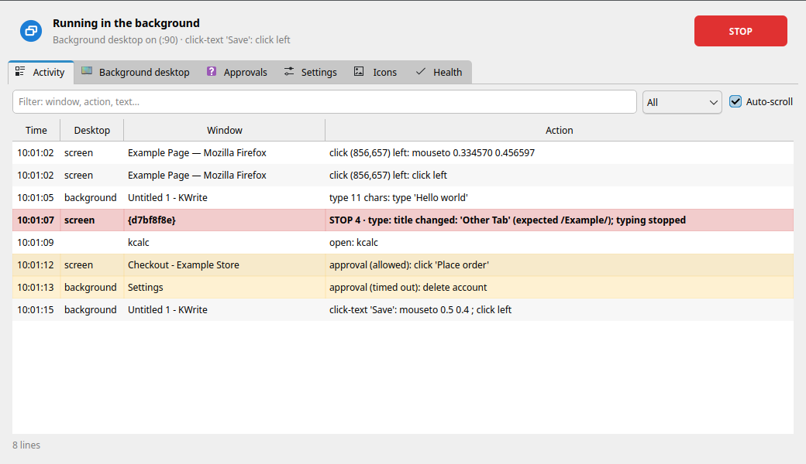
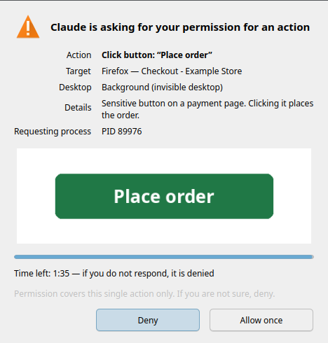
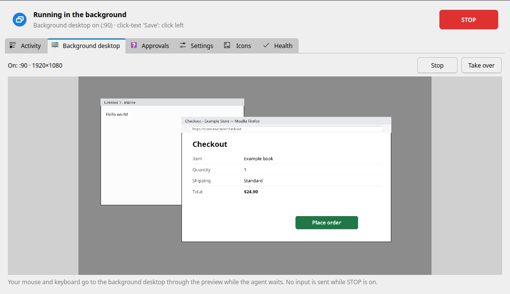

# Deskhand for KDE — MCP server that lets Claude Code and other AI agents use your KDE Plasma (Wayland) desktop, with approval for payments

*Türkçe: [README.tr.md](README.tr.md)*

Latest: 0.10.0 (Nov 2026) · GPL-3.0-or-later · free, no account · 20 MCP tools

[](LICENSE) [](https://registry.modelcontextprotocol.io/v0/servers?search=io.github.sobelendimm/deskhand)

**Deskhand for KDE is an MCP server that lets AI agents (Claude Code and other MCP clients) use
your KDE Plasma desktop on Wayland safely — on your screen, or on an invisible second desktop
(a KWin session) while you watch a movie.**

An agent can read windows, click on visible text, type and open apps. Every input is checked
against what is actually on screen at that moment. Buy/Pay buttons and payment pages wait
for **your** approval in a dialog the agent cannot reach. It stops the moment you touch the
mouse, and one click on **STOP** halts everything. When you are busy, the work moves to a
hidden desktop that can reuse some of your logged-in sessions, so your film or game is never
interrupted.

It is a safety layer for well-meaning agents, not a sandbox (see [Security model](#security-model)).

<p align="center">
  
  
</p>
<p align="center">
  
  
</p>

<sub>Screenshots are rendered from sample data.</sub>

## Features

### Safety layers

These are enforced in the tool itself, on both desktops, whatever the agent or its
permission mode says:

- **Forbidden windows.** Windows whose title or class matches a pattern in
  `~/.config/deskhand/yasak-pencereler.txt` never receive input, and their apps are never
  started (for example an online game whose rules forbid automation, or a password manager).
  Over MCP they are also blacked out in screenshots and left out of OCR.
- **Sensitive buttons and payment pages need a human.** Buy, Pay, Place order, Authorize,
  Allow, Delete account (Turkish and English wording) and any click or Enter on a page whose
  title looks like checkout/payment trigger an **approval dialog in the Deskhand panel**:
  *Allow once* or *Deny*, with a small picture of the target. Only the panel can write the
  answer; the dialog itself is a forbidden window, so the agent cannot click it. No answer,
  timeout or panel not running = denied.
- **Window/tab title lock.** With `-b PATTERN` (CLI) or a window pattern (MCP) the title is
  re-checked right before every input. If a browser switched tabs, typing stops mid-word.
- **Human priority.** If you are using the mouse or keyboard (Wayland idle notification, no
  extra permissions), Deskhand waits for 1.5 s of quiet, up to 8 s, then gives up. Keys it
  is holding are released as soon as you touch anything.
- **STOP switch.** Panel button, tray menu or an optional global shortcut. While it is on,
  nothing sends input and held keys are released. An agent may set STOP itself, but **it
  cannot lift a STOP that you set**. STOP comes off only with your Yes in the panel (the panel's
  Resume, the shortcut, or the question `deskhand resume` asks there, default No); `--approved` does
  not count as an answer. If the panel cannot read its signed STOP record at start (locked wallet,
  no Secret Service, unreadable or old-format record), it sets a STOP of its own. It removes only
  that one itself, once it reads a signed record that says STOP is off; a record from an older
  version needs your Resume once. An agent's `resume` never removes a STOP it did not set.
- **Activity log.** Every input is logged (`~/.local/state/deskhand`, kept 7 days, readable only by
  you: folder 0700, files 0600) and shown live in the panel. Text typed without `secret` shows up there in
  pieces, so type passwords, codes and personal data with `secret=true` (`--secret`).
  Limits of `secret`: the text is typed key by key and never goes through the clipboard, and the
  active window is checked before and after every key. The one check that cannot run is after the
  submit key (Enter), because a closing dialog or a moved focus is the normal outcome. The text and
  window titles are left out of the result, the log and the panel feed. Typing by window id or ref is
  locked to the window and its app class, not its title, so a tab or page switch inside the same
  window is not noticed. The focus is also checked right before each Enter, but a window change in
  the few milliseconds between that check and the key is not caught. A separate `observe` or
  screenshot call after the typing can still show a window title that contains the text. Type
  secrets into masked fields (password fields). Text sent to a terminal ends up in the shell's own
  history, outside Deskhand.

### Background desktop

`deskhand desktop start` starts an invisible desktop, separate from your session, 1920×1080
by default. It is an isolated, GPU-accelerated **KWin** session (`kwin_wayland`) when its
helpers are built; otherwise it falls back to **Xvfb + openbox** (X11 apps only, no GPU).
Every app there runs inside `bubblewrap`. You can run several desktops at once
(`--desktop-name NAME`, up to 3 by default): each Claude/MCP session gets its own and cannot
reach another session's desktop.

**For product images and sharp screenshots use `deskhand desktop start --scale 2`** (MCP:
`manage_desktop(action="start", scale=2)`; KWin type only). Apps keep the same layout and the same
coordinates but are drawn with twice the pixels: `deskhand screenshot --out product.png` saves the full
resolution (for example 3840×2160 on a 1920×1080 desktop), `--width 1280` scales it down. Firefox and
Chromium render at 2× too. `deskhand desktop status` shows the scale; to change it, stop the desktop and
start it again.

- **Nothing reaches you.** No input goes to your screen (the background backend can only
  talk to its own display). Apps there get a private D-Bus, so their notifications are
  captured to a log instead of popping up, and their audio goes to a silent sink.
  Wayland variables are removed from the Xvfb fallback so an app cannot escape to your screen.
  Inside the sandbox an app sees an empty home folder: only theme and appearance settings, XDG
  folder names, file associations and Flatpak installs of your real home are visible, read-only.
- **Light.** Low CPU/IO priority and a memory cap (systemd scope, 8 GB by default).
  Starting it takes about 0.2 s; an empty desktop uses about 30 MiB. An idle desktop closes
  itself after 30 minutes (`bosta_kapat_dk` in `ayarlar.toml`, `0` = off).
- **Memory watch.** Tool results carry a `memory_warning` field when the desktop uses 80% or more of
  its cap (anonymous + shared memory; page cache is not counted). When the desktop has been idle
  for 2 minutes and usage is at 85% or more, Deskhand restarts only Firefox with its session
  restored; other apps and the desktop stay open. Tabs come back from Firefox's own recovery file,
  written about every 15 seconds, so a tab opened in the last ~15 seconds can be lost, and window
  ids change (observe again). Firefox is left alone if the recovery file is missing or older than
  the running Firefox. At most one restart per 10 minutes and 3 per 24 hours; if a restart frees
  less than 10%, the next one waits 60 minutes (doubling each time, up to 24 hours). If a restart
  fails, the warning names the session backup (`sessionstore-backups/deskhand-yedek.jsonlz4` in the
  session copy) and the copy is kept for up to 24 hours, also across a desktop stop. At 60% or more
  (when no restart is due), `memory.reclaim` runs at most every 10 minutes. `DESKHAND_FF_YENIDEN=off` (also
  `false`, `0`, `no`, `kapali`) turns the restart off; the warning stays. While you or a task are
  using the desktop only the warning is given.
- **Per-app session policy.** Some apps can open there already logged in:
  - **Firefox:** a consistent, **one-way snapshot copy** of your profile (cookies, logins,
    site storage for the task's sites). Nothing is ever written back. Sync identity is left out;
    cookies **and saved passwords** of banking/payment/government sites (including Turkish banks and
    e-Devlet) and central login pages (Google, Microsoft) are not copied, so Google/YouTube are not signed
    in there. Camera, microphone, location and notification permissions are removed from the copy.
    If you want, panel → Settings → **Account sessions** lets a Microsoft, Google or e-Devlet session
    into the copy (off by default; it can only be turned on from the panel; bank and payment sites never
    open with any setting; not applied in task mode). While it is on, the background browser can reach that
    account's mail and files.
  - **Flatpak apps that do not use the keyring** (for example Discord, Spotify): snapshot copy.
  - **Apps that need the keyring** (VS Code and similar) and apps that write to real
    files (Obsidian vaults) run **only on your screen**.
  - **Chromium:** the native `chromium` opens on the background desktop with an **empty profile**:
    no saved logins, no password store. A second window opens in the same process. **Flatpak
    Chrome does not start there** (exit code 16 with the reason); use native `chromium` or your
    screen.
  - **Apps that break with two clients** (Telegram, Signal, WhatsApp wrappers, Element,
    Steam, Thunderbird and similar) are **never cloned** and never started in the
    background: the agent is told to wait for you. Mail/sync daemons (KMail/Akonadi,
    Nextcloud) are never started either.
  - The policy is matched on the resolved app (desktop entry, executable, Flatpak id), so a different
    name or path cannot bypass it; the strictest match wins. Password managers are never started.
  - Unknown apps start normally only when they are **certainly not running** for you (otherwise their
    single-instance lock could open the window on your screen); if that cannot be known, the agent
    waits. Policy file: `~/.config/deskhand/oturum.toml`.
  - **Persistent background sessions (opt-in).** For a site where you log in only on the background
    desktop, the panel can keep its session between copies: encrypted (AES-256-GCM) with a key in
    your KDE Wallet, fail-closed, never for banking/payment/government sites, and removable with
    `deskhand sessions forget <domain>`. Details: [docs/SESSIONS.md §3.8](docs/SESSIONS.md).
- **Watch and take over.** The panel shows a live preview of any running background desktop.
  *Take over* sends your mouse and keyboard into the background desktop while the agent waits.

### Busy detection: "Background / My screen / Later"

`deskhand busy` checks, read-only, whether you are busy: a fullscreen window, a playing
media player (MPRIS), recent keyboard/mouse input, a game or forbidden window, a locked screen.

`deskhand decide "task summary"` turns that into a decision. If you are not busy, the answer
is *my screen*. If you are, by default a notification asks **Background / My screen / Later**
(no answer in 45 s = background). Over a fullscreen film or game it does not interrupt you
at all and goes straight to the background. All of this is configurable in the panel.

### Clicking by text (OCR first)

Agents click on **what they can read**, not on guessed coordinates: `click-text <window> "Save"`.
Tesseract reads Turkish and English. With a graphics card, a second reader (EasyOCR on the GPU)
joins in by itself: it finds coloured web buttons and faint or small text that tesseract misses
(measured: 55/55 test phrases instead of 49/55, ~0.15 s per read). It only adds lines; tesseract's
reading is kept. It is never started while you play a game or watch something full screen, and it
frees the graphics memory after 5 idle minutes. Turkish letters are matched loosely (ş/s, ı/i…) and an
ambiguous match stops instead of guessing. Also available: the accessibility tree (AT-SPI,
click by button name), saved icon templates, colour areas, and screen-recognition *flows*
for repetitive tasks.

### What's new since 0.5.4

See [CHANGELOG.md](CHANGELOG.md) for the details.

- **Observe and batch:** `observe` lists a window's elements with numbered refs; `click`/`type_text`/`scroll`/`drag` work on those refs and are refused, with nothing sent, if the screen changed. `batch` runs up to 20 steps, `wait_for` waits for a condition.
- **Web elements:** the buttons/links/fields of a browser page are read from the accessibility tree; no remote-control port is opened on the browser.
- **Invisible desktop:** an isolated, GPU-accelerated KWin session (inside `bubblewrap`); Xvfb fallback when it is not available.
- **Approval scope "card payments only":** can only be turned on from the panel (Settings → Approval questions); only money buttons and typing card data ask. The default is "all".
- **Deskhand vault or KDE Wallet (new in 0.10.0):** saved passwords and the panel's signed settings record live in one of two stores. The *Deskhand vault* (default for new installs) keeps items as files sealed with `systemd-creds` (to the TPM2 when there is one, otherwise to the machine key) and makes no D-Bus or wallet call, so no wallet prompt appears at login. *KDE Wallet* is the Secret Service path used before. Switching asks you and moves the items. An install that already used the wallet stays on it until you choose the vault.
- **Settings → Advanced → Secrets (new in 0.10.0):** pick the store, see a status badge for it (ready with TPM / ready with the machine key / open / locked / unavailable and why), add or delete named saved passwords (values are never shown), and switch on **Open KDE Wallet at login**.
- **Saved passwords with per-site binding and per-use approval (new in 0.10.0):** `deskhand secret set NAME [--site DOMAIN] [--app WINDOW_CLASS]` (value from stdin, never from the command line), `secret list`, `secret rm`, `secret status`. An agent types one with `deskhand type <window> --secret-ref NAME` or the MCP `type_text` argument `secret_ref`. The value goes from the store straight to the keyboard layer and never appears in a result, the log or the panel feed. It is typed only into a password field (accessibility must be on, `deskhand a11y on`), and **every use asks in the panel** (name, window class, site; never the value). A password bound to a site or app is refused anywhere else.
- **Unlock KDE Wallet at login (new in 0.10.0):** `deskhand wallet open|status|remove`. Deskhand stores the wallet's derived key, not your password, sealed in the vault, and a user service (`deskhand-cuzdan-ac.service`) hands it to `ksecretd` at login, the way `kwallet-pam` does. If the wallet was already started and is locked when the service runs, nothing is forced: it logs one line and tries again at the next login, and Settings says so.
- **Persistent background sessions, account sessions, several desktops, `--scale 2`, file upload, `doctor`:** see the sections above and below.

### MCP server (20 tools)

`deskhand mcp` is a stdio MCP server with 20 tools: `get_status`, `choose_desktop`, `manage_desktop`,
`observe`, `screenshot`, `read_text`, `listen`, `find`, `click`, `type_text`, `clipboard`, `press_key`,
`scroll`, `drag`, `open_app`, `manage_window`, `run_flow`, `batch`, `wait_for`, `request_human`.
`type_text` also takes `secret_ref` (the name of a saved password, see above) instead of `text`.
Screenshots are scaled to 1280 px on the long edge. Coordinates are checked against a `shot_id`, so a
click on a stale screenshot is refused. There is no "approved" flag on the MCP surface: sensitive
actions always go through the panel.

### Monitoring panel and tray

Activity (live log, filter), background desktops (picker, live view, stop, take over), task
(give the panel's own agent a job on the invisible desktop), approvals (pending + history),
settings (busy behaviour, forbidden windows, STOP shortcut, approval scope, account sessions, secrets),
saved icons and a health check of all dependencies. The tray icon shows idle / on your screen /
in the background / STOP, with a badge when an approval is waiting.

## How it compares

There are good projects in this space; pick what fits you.

- [agent-sh/agent-workspace-linux](https://github.com/agent-sh/agent-workspace-linux) is the
  closest: a hidden desktop on six backends (including a native KWin Wayland virtual
  compositor), keyring and Chrome profile import, app allow-list, a live viewer, 82 tools.
  It is broader and more portable than Deskhand.
- [ahmetadakli/kde-desktop-mcp](https://github.com/ahmetadakli/kde-desktop-mcp) has the
  closest safety model on KDE: app allow-list with levels, confirmation list, password-field
  protection, user-takeover pause, stop shortcut. It works through the accessibility tree.
- [isac322/kwin-mcp](https://github.com/isac322/kwin-mcp) is for KDE Plasma 6 Wayland: it sends
  input through KWin's EIS interface and opens an isolated `kwin_wayland --virtual` for each
  session; it has accessibility-tree, clipboard and touch-gesture tools. It has no approval or
  human-priority layer.
- [agent-sh/computer-use-linux](https://github.com/agent-sh/computer-use-linux) (GNOME-first,
  many backends), [Samthesurf/kwin-mcp](https://github.com/Samthesurf/kwin-mcp) (KDE Wayland),
  [alex-oleshkevich/wayland-mcp](https://github.com/alex-oleshkevich/wayland-mcp)
  (niri/wlroots, nested sandbox, local OCR) are other options.

What Deskhand puts together, which we have not seen combined elsewhere:

1. **Checks based on what is on screen**, not only on which app: forbidden windows,
   sensitive buttons, payment-page detection, title/class lock.
2. **Busy detection** and the *Background / My screen / Later* loop.
3. **Session policy per app** for the background desktop (copy / wait / never), including the
   apps that must not run twice.
4. **Click by visible text with Turkish OCR**, also where there is no accessibility tree.
5. **A Plasma panel**: tray, STOP, live preview, take over, human-only approvals.

It is also smaller in scope: KDE Plasma only, and no GPU on the Xvfb fallback.

## Requirements

- **KDE Plasma 6 on Wayland** for the foreground (your own screen). The background desktop is an
  isolated, GPU-accelerated **KWin** session (`kwin_wayland`) when the helpers are built; if they
  are not, or KWin is unavailable, it starts with **Xvfb** and runs only apps that support **X11**.
- Python **3.11+**
- Foreground: `kdotool`, `dotool`, `spectacle`, access to `/dev/uinput`
- Both: `tesseract` with Turkish and English data
- Background (**required**): `bubblewrap` (`bwrap`): every app on the background desktop is
  isolated with it; without it no app opens in the background
- Background: `Xvfb`, `openbox`, `python-xlib`; recommended `xdotool`, `pactl` (silent audio
  sink; without it background apps get no audio at all), `systemd-run` (memory cap)
- Python modules: PyQt6, python-xlib, numpy, scipy, pillow, jeepney, mcp ≥ 2.3
- To build the small keyboard-activity helper: a C compiler, `make`, `pkg-config`, `wayland`
  (without it, human priority watches only the mouse)
- With an AMD or NVIDIA graphics card, for text recognition on the GPU: PyTorch for your card,
  torchvision, OpenCV, scikit-image, shapely, pyclipper, and EasyOCR in a small venv with its
  models (~100 MB). Without a GPU nothing extra is needed. `install.sh` checks all of it and prints
  the commands
- `make -C deskhand/yardimci` builds three helpers: `deskhand-etkinlik`, `deskhand-goruntu`
  (KWin's screenshot interface, about 8 ms a shot) and `deskhand-eis` (input for the KWin background
  desktop). The last one needs the `libei`, `libxkbcommon` and `libsystemd` development packages;
  without it the background desktop starts with Xvfb. `install.sh` builds them and registers the
  desktop input; `deskhand doctor` and the panel's Health tab show which one is missing

Arch / CachyOS:

```bash
sudo pacman -S --needed spectacle tesseract tesseract-data-tur tesseract-data-eng \
    xorg-server-xvfb openbox xdotool libpulse bubblewrap libei libxkbcommon python-pyqt6 python-xlib python-numpy \
    python-scipy python-pillow python-jeepney python-mcp base-devel wayland
paru -S kdotool-bin dotool        # AUR (or yay, or by hand)

# with a graphics card (NVIDIA: python-pytorch-opt-cuda instead of -rocm)
sudo pacman -S --needed python-pytorch-opt-rocm python-torchvision python-opencv \
    python-scikit-image python-shapely python-pyclipper
python3 -m venv --system-site-packages ~/.local/share/deskhand/ocr-venv
~/.local/share/deskhand/ocr-venv/bin/python -m pip install --no-deps easyocr python-bidi
cd ~/.local/src/deskhand && ~/.local/share/deskhand/ocr-venv/bin/python -m deskhand.ocr_gpu indir   # models
```

`dotool` needs to write to `/dev/uinput`. Its package installs a udev rule for the `input`
group, so:

```bash
sudo usermod -aG input "$USER"                        # then log out and back in
sudo modprobe uinput                                  # if /dev/uinput does not exist
echo uinput | sudo tee /etc/modules-load.d/uinput.conf   # load it at boot
```

## Supported systems

| Status | System |
| ------ | ------ |
| **Tested** | CachyOS (Arch) with KDE Plasma 6.8 on Wayland. This is the only setup the author has run Deskhand on. |
| **Expected to work (untested)** | Arch Linux, EndeavourOS and Manjaro with Plasma 6.8 (same packages, same repositories). |
| **Not yet** | Fedora, openSUSE, Debian and Ubuntu (and their KDE spins): most ship KWin older than 6.8 or lack packages Deskhand needs (`kdotool`, `dotool`, `mcp` 2.3+), and `install.sh` only prints `pacman` commands. With KWin older than 6.8 the background desktop falls back to Xvfb (X11 apps only). GNOME and other desktops: only the background desktop could work (Xvfb), the foreground needs KDE. Windows, macOS and BSD: not supported (Linux-only parts: `uinput`, D-Bus, `bubblewrap`, `systemd`). |

Helpers (`kdotool`, `dotool`, `bwrap`) are looked up only in `/usr/bin` and `/bin`, and the Python module `mcp`
must be 2.3 or newer and importable by the system `python3`.

Want your distribution supported? [Open an issue](https://github.com/sobelendimm/deskhand/issues) with
your `deskhand doctor` output: testing on other systems takes real time, and reports from other setups
are the fastest way to get them covered.

## Install

Clone it anywhere and run the installer as your normal user (not with `sudo`):

```bash
git clone https://github.com/sobelendimm/deskhand.git ~/.local/src/deskhand
cd ~/.local/src/deskhand
./install.sh --dry-run    # see what it will do
./install.sh              # install (safe to re-run)
```

The installer **does not install packages**. It lists what is missing and prints the
command. It then builds the helpers and installs:

- the `deskhand` command in `~/.local/bin` (points at this folder; if you move the folder,
  run `./install.sh` again),
- a menu entry and icon,
- panel autostart (tray only) at login, because approvals need the panel running
  (`./install.sh --no-autostart` to skip).

Nothing is installed system-wide. Update: `git pull && ./install.sh`. Uninstall:
`./uninstall.sh` (keeps settings, saved icons and flows) or `./uninstall.sh --purge`.

### With pipx

```bash
pipx install deskhand
deskhand doctor    # lists missing system tools with Arch / Debian / Fedora package names
```

pipx installs the Python side only. System tools come from your distribution (kdotool,
dotool, tesseract with English/Turkish data, Xvfb, openbox, bubblewrap). To build the small C
helpers, install a C compiler, make, pkg-config and the wayland-client, libsystemd, libei
(>= 1.3.901) and xkbcommon development files, then run the `make -C …` command that
`deskhand doctor` prints (run it again after `pipx upgrade`). Without libei the background
desktop uses Xvfb. For the menu entry, the icon and the panel at login (approvals need the
panel running), run `deskhand install-desktop` (`--no-autostart` to skip the login entry,
`--remove` to take back only what it wrote). With a graphics card, `deskhand doctor` also
prints the commands for GPU text recognition (its own venv and models).

## Quick start

```bash
deskhand panel                          # monitoring panel + tray
deskhand busy                           # are you busy? (read-only)
deskhand windows [firefox]              # find windows: id | title | geometry (no pattern: all)
deskhand screenshot --out screen.png --width 800   # no id: active window (--background: the whole invisible desktop)
deskhand read firefox                   # read the window's text with coordinates (OCR)
deskhand -b "Example" click-text firefox "Sign in"     # click visible text, title locked
deskhand --background open firefox --site github.com   # signed-in Firefox on the invisible desktop
deskhand --background open firefox https://example.com # starts the desktop if it is off; http/https only
deskhand goto <window> https://example.com             # go to an address in a browser (ctrl+l → address → Return)
deskhand stop                           # STOP: no input from now on
deskhand resume                         # ask the panel to lift a STOP (needs your Yes there)
```

Cheat sheet (`deskhand --help` lists the subcommands as a table, `deskhand help` shows the full syntax; the Turkish names work too, in parentheses):

| Command | Meaning |
|---|---|
| `windows` (`bul`) `[pattern]` | find windows (no pattern: all windows; a forbidden window's title is not shown) |
| `screenshot` (`foto`) `[window] [--out FILE] [--width N]` | screenshot; no id: the whole invisible desktop with `--background`, else the active window (exit 17 if the real screen is locked); `--width`: scaled-down image |
| `read` (`metin`) `<window> [pattern]` | read text + coordinates (OCR) |
| `click-text` (`metne-tikla`) `<window> <text>` | click on visible text |
| `click` (`tikla`) `<window> <x> <y>` | click at window coordinates |
| `type` (`yaz`) `<window> <text>` | type text (`--secret`: not written to the log) |
| `key` (`tus`) `<window> <keys>` | key or shortcut, e.g. `ctrl+s` |
| `scroll` (`kaydir`) `<window> [down\|up]` | scroll |
| `wait` (`bekle`) `<window> <text>` | wait until text appears (`--gone`: disappears) |
| `open` (`ac`) `<app> [url]` / `open --command "CMD"` | start an app and wait for its new window; `--url`/positional address is http/https only (also for session-copied browsers); `--background` starts the desktop if it is off |
| `goto` (`git`) `<window> <url>` | go to an address in a browser window through the existing `key`/`type` checks (title lock, sensitive-page approval, human-verification gate); http/https only |
| `choose-file` (`dosya-sec`) `<dialog> <path>` | pick a file in a file chooser, verified (see [Uploading files](#uploading-files-file-chooser)) |
| `tree` (`agac`) / `click-element` (`ogeye-tikla`) | accessibility tree / click an element by name |
| `desktop` (`masaustu`) `start\|stop\|status\|list` | the background desktop(s) |
| `sessions` (`oturum`) `status\|policy\|clear\|check\|forget` | which apps open signed in on the background desktop; `check <site>`: is that site's session alive there (prints no values; exit 0 = yes, 1 = login needed); `forget`: delete stored persistent sessions |
| `busy` (`mesgul`) · `decide` (`karar`) `"<task>"` | busy check · decide where to work |
| `stop` · `resume` · `status` (`dur` · `devam` · `durum`) | STOP on · off · show |
| `doctor` (`doktor`) | health check of every dependency, helper and running MCP server |
| `panel [--tepsi]` · `mcp` | panel (tray only) · MCP server |

Common options: `-b/--title PATTERN` title lock, `-s/--class PATTERN` class lock, `--background`
run on the invisible desktop, `--desktop-name NAME` pick one of several invisible desktops (it also means
`--background`), `--on-my-screen` work on your screen even during a game or movie (only when you said so).
The Turkish option names (`--baslik`, `--arka`, `--ekranimda`…) and the old `ekran` command keep working.

## Use with Claude Code (MCP)

Register two entries in **user** scope (never `project` scope: desktop control should not
travel with a repository). Claude Code permission rules cannot match tool parameters, so the
desktop split is done by server name:

```bash
claude mcp add --scope user --transport stdio deskhand    -- ~/.local/bin/deskhand mcp
claude mcp add --scope user --transport stdio deskhand-bg -- ~/.local/bin/deskhand mcp --desktop background
claude mcp get deskhand        # inside a session: /mcp
```

| Name | Can touch | Suggested permission |
|---|---|---|
| `deskhand` | your screen and the background desktop (`desktop=auto` by default) | `ask` |
| `deskhand-bg` | the background desktop **only** (foreground requests are refused) | can be more relaxed |

Example `~/.claude/settings.json`:

```json
{
  "permissions": {
    "allow": ["mcp__deskhand__get_status", "mcp__deskhand__read_text", "mcp__deskhand__find",
              "mcp__deskhand-bg__get_status", "mcp__deskhand-bg__read_text", "mcp__deskhand-bg__screenshot"],
    "ask":   ["mcp__deskhand__screenshot", "mcp__deskhand__click", "mcp__deskhand__type_text",
              "mcp__deskhand__press_key", "mcp__deskhand__scroll", "mcp__deskhand__open_app",
              "mcp__deskhand__run_flow", "mcp__deskhand__manage_desktop"]
  }
}
```

The example lists a few tools only; list the other tools of the server (`observe`, `batch`, `drag`,
`clipboard`, …) the same way, or they follow your client's default.
Permission prompts are a second layer; Deskhand's own checks run in every permission mode.
The server needs `WAYLAND_DISPLAY`, `DBUS_SESSION_BUS_ADDRESS` and `XDG_RUNTIME_DIR` for the
foreground; if your client starts it with an empty environment, pass them with `--env`.

A typical session: `get_status` → (busy?) `choose_desktop` → `manage_desktop start` →
`open_app` → `read_text` → `click(text="Save", verify=true)` → `type_text` → `read_text` to
check → `manage_desktop stop`.

## Agent usage pattern (CLI)

Ask first, then run every command on the chosen desktop:

```bash
deskhand decide "Save the invoice as PDF"
case $? in
    0)  WHERE="" ;;          # my screen
    20) WHERE="--background" ;;    # background desktop
    21) exit 0 ;;            # later: tell the user, do nothing now
esac
deskhand $WHERE open --command "okular ~/invoice.pdf"
```

The global options (`--desktop-name NAME`, `--background`) go **before** the command, and they also come first
when you use `--`: `deskhand --desktop-name w1 --background tree <id>`. zsh does not split a variable that holds
spaces (`$WHERE="--a --b"`); use the environment instead: `export DESKHAND_HEDEF=arka DESKHAND_MASAUSTU=w1`, then plain
`deskhand tree <id>`. The hints in error messages give complete commands in this form, ready to run as they are.

### Uploading files (file chooser)

A "Choose file" button on a page opens the GTK file chooser. Do not type the path by hand (ctrl+l → path → Enter):
if the location entry does not open, the typed path goes to the list's type-ahead search and Enter can pick the
wrong file. Use this instead:

```bash
deskhand --background windows                       # find the dialog's id ("File Upload - …")
deskhand --background choose-file <dialog> ~/Downloads/document.pdf   # Turkish: dosya-sec
```

`choose-file` checks through AT-SPI that the location entry has focus, reads the typed path back (it does not press
Enter unless it matches exactly; it stops with 8), and waits for the dialog to close. Apps on the invisible desktop
see only the XDG folders (Downloads, Documents, Desktop…): copy a file from `/tmp` or another home folder to, for
example, `~/Downloads` first.

Rules for agents: stop on exit codes 10, 12, 13, 15, 16 and 18 and tell the user; read before you click
and verify after; pass `--approved` only when the user has approved that exact step in the
chat. Without it, Deskhand asks the user in the panel.

## Configuration

| Path | Contents |
|---|---|
| `~/.config/deskhand/yasak-pencereler.txt` | forbidden windows (regex per line, title or class) |
| `~/.config/deskhand/ayarlar.toml` | busy behaviour (`[karar]`: ask / background / wait, timeout, ask over fullscreen), idle desktop close, persistent sessions (`[oturum] kalici`) |
| `~/.config/deskhand/oturum.toml` | per-app session policy for the background desktop (merged over the defaults) |
| `~/.local/share/deskhand/` | saved icons (`simgeler/`), flows (`akislar/`), encrypted persistent sessions (`oturum-kalici/`) |
| `~/.local/state/deskhand/` | input log (7 days), captured background notifications (0700) |
| `~/.cache/deskhand/` | screenshots, OCR cache (5 days, 0700) |
| `$XDG_RUNTIME_DIR/deskhand/` | STOP switch, approval requests, background desktop state, session copies (tmpfs, 0700) |

Every directory can be moved with `DESKHAND_CONFIG_DIR`, `DESKHAND_STATE_DIR`,
`DESKHAND_CACHE_DIR`, `DESKHAND_DATA_DIR`, `DESKHAND_RUNTIME_DIR`. Other variables:
`DESKHAND_HEDEF=on|arka|oto` (default desktop), `DESKHAND_SANAL_BOYUT=1920x1080` (background
size), `DESKHAND_SANAL_BELLEK=8G` (memory cap, `0` = off). `DESKHAND_GERCEK_EKRAN=kapali` locks your
real screen for that process at the lowest layer (input, window actions, app launch, clipboard write,
notifications, screenshots all fail with exit code 17; `salt-okuma` still allows reading
screenshots and the clipboard): set it in test and measurement scripts so a forgotten background
target cannot touch your desktop.

## Exit codes

| Code | Meaning |
|---|---|
| 0 | done |
| 1 | usage error |
| 2 | point outside the window/screen |
| 3 | window is not active / another window is in front |
| 4 | title or class lock did not match |
| 5 | several matches (give `--sira N`) |
| 6 | text not found |
| 7 | timeout |
| 8 | window gone or moved |
| 9 | a required tool did not run (dotool, tesseract, Xvfb…) |
| 10 | forbidden window, a sensitive action without approval, or the panel could not verify its forbidden-window list / access levels (see Security model) |
| 11 | a flow reached an error screen |
| 12 | you are using the computer (human priority) |
| 13 | STOP is on |
| 14 | background desktop not available |
| 15 | you are playing a game or watching a video: your screen is not touched |
| 16 | the app cannot be opened on the background desktop (open on your screen, keyring-only, or Flatpak Chrome: use native `chromium`) |
| 17 | your real screen is locked for this process (`DESKHAND_GERCEK_EKRAN`): use the background desktop |
| 18 | a human-verification challenge (CAPTCHA) is in the way: never solved or bypassed; hand over with `request_human` |
| 20 / 21 | `decide`: background / later (0 = your screen) |

Over MCP the same codes appear as `[code] name: detail` errors.

## Known limitations

- **A lone web button** can be missing from the full `read` listing; searching for its text
  (`read <window> "<text>"`, `click-text`) uses extra readings and finds it.
- **No GPU on the Xvfb fallback.** If the KWin background desktop is not available, Xvfb draws in
  software: WebGL, games and video decoding are slow there.
- **Wayland-only apps cannot run on the Xvfb fallback** (it is X11).
- **Without `bubblewrap` no app opens in the background.**
- **Keyring apps are foreground-only.** VS Code and anything that
  keeps its secrets in KWallet/Secret Service do not open logged in on the background desktop. Native `chromium` opens there with an empty profile; Flatpak Chrome does not open there.
- **Up to 3 background desktops** at a time (`[masaustu] azami`, 1..6).
- **OCR can misread.** Ambiguous matches stop rather than guess, and clicks can be verified,
  but small or low-contrast text may be read wrong or not found.
- **Approvals need the panel running.** If it is closed, every sensitive action is denied.
- **Foreground needs Plasma 6 on Wayland** (kdotool + KWin scripting).
- More detailed and current limits (card-number capture, panel-marker forgery, no sandbox, overlapping
  elements, …): "Known limitations" in [`CHANGELOG.md`](CHANGELOG.md).
- The activity log is written in Turkish (the panel shows it translated); messages, help and the panel follow
  your system language (Turkish or English), or the choice in Settings.

## Security model

Deskhand protects you from an agent's **mistakes** and from a **confused or deceived agent**:
prompt injection (a web page or document telling the agent to buy something or delete an account),
wrong targets, runaway loops. The agent has no tool or command that approves its own request
or lifts your STOP. That is what the approval dialog, STOP, the forbidden-window list and the
busy checks are for.

It is **not a sandbox**, and it does not defend against code that already runs as you:

- **A malicious process under the same user account can act like the panel.** The panel is recognised by
  its process identity (socket peer, start time, executable, command line, working directory). That
  is a check against a misbehaving agent, not against another program running as the same user,
  which can imitate the panel, answer approvals, or edit your files directly. This is a known design
  limit; a same-user process can also drive the desktop without Deskhand.
- **The settings that only the panel may loosen are in the same class.** The forbidden-window list,
  the app access levels, the approval scope "card payments only", account sessions, persistent
  sessions and your STOP are anchored in a record the panel keeps in your Secret Service (KDE
  Wallet) and signs with a key stored there. Tightening a setting in the file is accepted; loosening
  it applies only after your Yes in the panel (default No), so an agent that edits the settings
  file by hand gains nothing. Every such question shows the exact entries Deskhand will apply, and a
  Yes counts only for that text. If the panel cannot read its record (locked wallet, no Secret
  Service) and it is not a first start, the forbidden-window list and access levels are asked in
  one dialog; on No they count as not verified, and clients stop with exit code 10 until the wallet
  can be read. Settings shows an unverified list read-only. This does not cover code running as you
  that deliberately reads or changes the wallet item (KDE Wallet has no per-application access
  control), or that deletes the item while the wallet is open (that looks like a first start).
- **The Deskhand vault is not stronger than an unlocked wallet against code running as you.** A process under
  your user account can run `systemd-creds --user decrypt` on a vault item, just as it could read an unlocked
  KDE Wallet with `secret-tool`; a locked wallet is the stronger choice against that. The vault detects a
  rolled-back copy of the panel's record only while some Deskhand process has seen the newer one; with no
  Deskhand process running, restoring an old copy is not noticed (a TPM counter was not available to anchor it).
  `secret_ref` is an extra: each use needs your Yes in the panel and the value goes only into a password field.
- **An agent that can run arbitrary shell commands as your user** can edit files, kill the panel or drive
  the desktop without Deskhand. Keep shell access behind your client's permission prompts.
- Apps on the background desktop run inside `bubblewrap` (read-only root, empty home, masked secret
  paths). That limits what those apps see; it is not a promise about what a hostile app can do.

See [SECURITY.md](SECURITY.md) for how to report a problem.

## Development

```bash
for t in tests/test_*.py; do python3 "$t" || break; done
```

`test_mantik`, `test_ocr`, `test_ocr_gpu`, `test_onay`, `test_oturum`, `test_entegrasyon`, `test_mesgul`, `test_guvenlik`,
`test_i18n` and `test_gui` (offscreen Qt) need no screen (`test_ocr_gpu` also runs the real GPU reader
when it is installed and you are not in a game). `test_sanal` and `test_mcp` start their own
background desktop; nothing goes to your screen.

Tests redirect every Deskhand directory to a temporary folder and never touch your real
config. The suites in `tests/ekranli/` drive your **real** screen; run them only when you are
not using the computer: `tests/ekranli/hepsi.sh` runs them all (~15 min; it opens its own Firefox with a
temporary profile, never yours; `--insansiz` skips the two steps that ask you to click in the approval dialog).
See [CONTRIBUTING.md](CONTRIBUTING.md).

## Support

Deskhand is free software, written and maintained by one person. If it saves you time, a star on
GitHub helps other people find it, and bug reports, tests on other Plasma setups and pull requests
help the project the most. A GitHub Sponsors page is on the way.

## License

[GPL-3.0-or-later](LICENSE) © 2026 sobelendimm.
