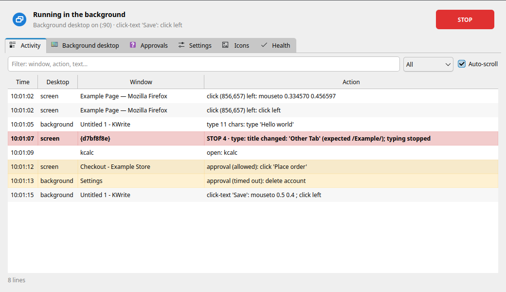
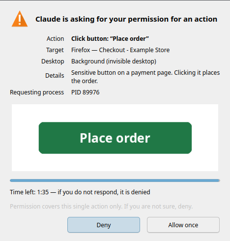
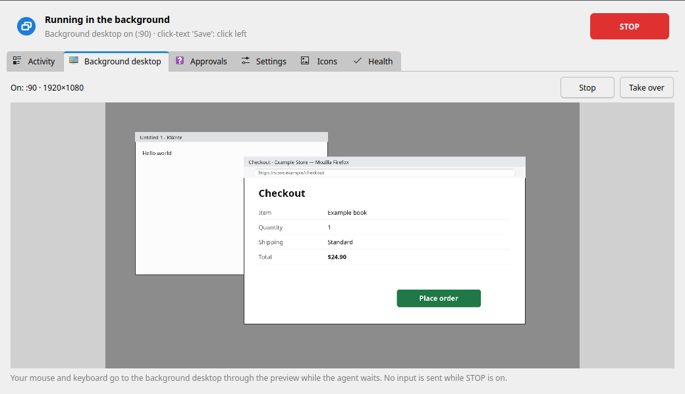

# Deskhand for KDE — Claude Code ve diğer yapay zekâ ajanlarının KDE Plasma (Wayland) masaüstünüzü kullanmasını sağlayan, ödemelerde onay isteyen MCP sunucusu

*English: [README.md](README.md)*

Son sürüm: 0.10.0 (Kasım 2026) · GPL-3.0-or-later · ücretsiz, hesap gerekmez · 20 MCP aracı

[](LICENSE) [](https://registry.modelcontextprotocol.io/v0/servers?search=io.github.sobelendimm/deskhand)

**Deskhand for KDE, yapay zekâ ajanlarının (Claude Code ve diğer MCP istemcileri) Wayland'daki
KDE Plasma masaüstünüzü güvenle kullanmasını sağlayan bir MCP sunucusudur: ister sizin
ekranınızda, ister siz film izlerken görünmez ikinci bir masaüstünde (KWin oturumu).**

Ajan pencereleri okuyabilir, ekranda gördüğü yazıya tıklayabilir, yazı yazabilir, uygulama
açabilir. Her girdi, o anda ekranda gerçekten ne olduğuna bakılarak denetlenir. Satın al/Öde
düğmeleri ve ödeme sayfaları, ajanın erişemediği bir pencerede **sizin** yanıtınızı bekler.
Fareye dokunduğunuz an durur; tek tıkla **DUR** her şeyi keser. Meşgulseniz iş, giriş
yapılmış bazı oturumlarınızı kullanabilen gizli bir masaüstüne taşınır; filminiz ya da
oyununuz bölünmez.

İyi niyetli ajanlar için bir güvenlik katmanıdır, kum havuzu (sandbox) değildir
(bkz. [Güvenlik modeli](#güvenlik-modeli)).

<p align="center">
  
  
</p>
<p align="center">
  
  
</p>

<sub>Ekran görüntüleri örnek verilerle üretildi.</sub>

## Özellikler

### Güvenlik katmanları

Ajan ya da izin kipi ne derse desin, iki masaüstünde de aracın kendisi uygular:

- **Yasak pencereler.** Başlığı ya da sınıfı `~/.config/deskhand/yasak-pencereler.txt`
  içindeki bir desene uyan pencerelere hiçbir girdi gitmez, uygulamaları başlatılmaz
  (örneğin otomasyonu kurallarıyla yasaklayan çevrim içi bir oyun ya da parola yöneticisi).
  MCP üzerinden ekran görüntüsünde siyah kutu olurlar, OCR'a da girmezler.
- **Hassas düğmeler ve ödeme sayfaları insana sorulur.** Satın al, Öde, Siparişi onayla,
  Yetkilendir, İzin ver, Hesabı sil (Türkçe ve İngilizce karşılıklarıyla) ve başlığı
  ödeme/sipariş sayfasına benzeyen bir sayfadaki her tıklama ya da Enter, **Deskhand
  panelinde bir onay diyaloğu** açar: hedefin küçük bir görüntüsüyle *Bir kez izin ver* ya da
  *Reddet*. Yanıtı yalnız panel yazar; diyaloğun kendisi de yasak penceredir, ajan ona
  tıklayamaz. Yanıt yoksa, süre dolarsa ya da panel kapalıysa cevap: red.
- **Pencere/sekme başlığı kilidi.** `-b DESEN` (CLI) ya da pencere deseni (MCP) verilince
  başlık her girdiden hemen önce yeniden denetlenir. Tarayıcı sekme değiştirirse yazı
  kelimenin ortasında kesilir.
- **İnsan önceliği.** Fareyi ya da klavyeyi kullanıyorsanız (Wayland boşta bildirimi, ek
  yetki gerekmez) Deskhand 1,5 sn sessizlik bekler, en çok 8 sn; olmazsa vazgeçer. Basılı
  tuttuğu tuşları, siz herhangi bir şeye dokunduğunuz an bırakır.
- **DUR anahtarı.** Paneldeki düğme, tepsi menüsü ya da isteğe bağlı genel kısayol. Açıkken
  hiçbir girdi gönderilmez, basılı tuşlar bırakılır. Ajan da DUR diyebilir, ama **sizin
  koyduğunuz DUR'u kaldıramaz**. DUR yalnız panelde verdiğiniz Evet ile kalkar (panelin Devam düğmesi,
  kısayol ya da `deskhand resume`'un orada sorduğu soru; varsayılan Hayır); `--approved` yanıt sayılmaz.
  Panel açılışta imzalı DUR kaydını okuyamazsa (kilitli cüzdan, Secret Service yok, okunamayan ya da
  eski biçimli kayıt) kendi DUR'unu koyar. Yalnız onu, imzalı kayıtta DUR'un kapalı olduğunu okuyunca
  kendisi kaldırır; eski sürümün kaydı için bir kez Devam'a basmanız gerekir. Ajanın `resume`'u
  kendi koymadığı DUR'u kaldırmaz.
- **Etkinlik günlüğü.** Her girdi günlüğe yazılır (`~/.local/state/deskhand`, 7 gün; yalnız siz
  okuyabilirsiniz: klasör 0700, dosyalar 0600) ve panelde canlı görünür. `secret` olmadan yazılan metinler
  günlükte parça parça görünür: parola, kod ve kişisel bilgileri `secret=true` (`--secret`) ile yazın.
  `secret` sınırları: metin harf harf yazılır, panoya hiç girmez; her harften önce ve sonra etkin pencere
  yoklanır. Yalnız gönder tuşundan (Enter) sonra yoklanmaz, çünkü diyaloğun kapanması ya da odağın taşınması
  olağan sonuçtur. Metin ve pencere başlıkları sonuçta, günlükte ve panel akışında yer almaz. Pencere
  kimliği ya da ref ile yazı, pencereye ve uygulama sınıfına kilitlidir, başlığa değil; aynı pencere
  içindeki sekme ya da sayfa değişimi fark edilmez. Her Enter'dan hemen önce de odak yoklanır, ama bu
  yoklama ile tuş arasındaki birkaç milisaniyede pencere değişirse yakalanmaz. Yazıdan sonraki ayrı bir
  `observe` ya da ekran görüntüsü, metni içeren bir pencere başlığını yine gösterebilir. Gizli metni
  maskeli alanlara (parola alanı) yazın. Uçbirime giden metin kabuğun kendi geçmişine girer; bu
  Deskhand'in dışındadır.

### Arka plan masaüstü

`deskhand desktop start` görünmez bir masaüstü açar: sizin oturumunuzdan ayrı, varsayılan 1920×1080.
Yardımcılar derlenmişse yalıtık, ekran kartı hızlandırmalı bir **KWin** oturumudur (`kwin_wayland`);
değilse **Xvfb + openbox** yedeğine düşer (yalnız X11 uygulamaları, GPU yok). Oradaki her uygulama
`bubblewrap` içinde çalışır. Aynı anda birden çok masaüstü açılabilir (`--desktop-name AD`, varsayılan en
çok 3): her Claude/MCP oturumu kendi masaüstünü alır ve başka oturumun masaüstüne erişemez.

**Ürün görseli / keskin ekran görüntüsü için `deskhand desktop start --scale 2`** (MCP:
`manage_desktop(action="start", scale=2)`; yalnız KWin türü). Uygulamalar aynı yerleşimde ve aynı
koordinatlarla çalışır ama ekran iki kat pikselle çizilir: `deskhand screenshot --out urun.png`
tam çözünürlüğü (ör. 1920×1080 masaüstünde 3840×2160) kaydeder, `--width 1280` küçültür. Firefox ve
Chromium da 2× çizer. `deskhand desktop status` ölçeği gösterir; ölçeği değiştirmek için masaüstünü
kapatıp yeniden açın.

- **Size hiçbir şey ulaşmaz.** Ekranınıza girdi gitmez (arka plan arka ucu yalnız kendi
  ekranıyla konuşabilir). Oradaki uygulamaların D-Bus'ı ayrıdır: bildirimleri ekranınıza
  düşmez, günlüğe yakalanır; sesleri sessiz bir çıkışa gider. Wayland değişkenleri Xvfb yedeğinde
  silinir, böylece bir uygulama ekranınıza kaçamaz. Kum havuzunun içinde uygulama boş bir ev
  dizini görür: gerçek evinizden yalnız tema ve görünüm ayarları, XDG klasör adları, dosya
  ilişkilendirmeleri ve Flatpak kurulumları salt okunur görünür.
- **Hafif.** Düşük işlemci/disk önceliği ve bellek sınırı (systemd kapsamı, varsayılan
  8 GB). Açılışı yaklaşık 0,2 sn sürer; boş masaüstü ~30 MiB kullanır. Boştaki masaüstü 30 dakika
  sonra kendiliğinden kapanır (`ayarlar.toml` içinde `bosta_kapat_dk`, `0` = kapalı).
- **Bellek izleme.** Masaüstü bellek sınırının %80'ini ya da fazlasını kullanınca araç sonuçlarına
  `memory_warning` alanı eklenir (anonim + paylaşılan bellek; sayfa önbelleği sayılmaz). Masaüstü 2 dakika
  boşta kalır ve kullanım %85 ya da üstündeyse Deskhand yalnız Firefox'u, oturumu geri yüklenerek yeniden
  başlatır; diğer uygulamalar ve masaüstü açık kalır. Sekmeler Firefox'un yaklaşık 15 saniyede bir yazdığı
  kurtarma dosyasından gelir: son ~15 saniyede açılan sekme kaybolabilir, pencere kimlikleri değişir (yeniden
  gözlem yapın). Kurtarma dosyası yoksa ya da çalışan Firefox'tan eskiyse Firefox'a dokunulmaz. 10 dakikada en
  çok bir, 24 saatte en çok 3 yeniden başlatma; yeniden başlatma belleği %10'dan az azaltırsa sonraki 60 dakika
  beklenir (her seferinde iki katı, en çok 24 saat). Başarısız olursa uyarı oturum yedeğinin yolunu verir
  (oturum kopyasında `sessionstore-backups/deskhand-yedek.jsonlz4`) ve kopya en çok 24 saat korunur;
  masaüstü durdurulsa da silinmez. %60 ve üstünde (yeniden başlatma sırası yokken) `memory.reclaim` en çok
  10 dakikada bir çalışır. `DESKHAND_FF_YENIDEN=off` (ya da `false`, `0`, `no`, `kapali`) yeniden başlatmayı
  kapatır; uyarı kalır. Siz ya da bir görev masaüstünü kullanırken yalnız uyarı verilir.
- **Uygulama başına oturum politikası.** Bazı uygulamalar orada girişli açılabilir:
  - **Firefox:** profilinizin tutarlı, **tek yönlü anlık kopyası** (çerezler, girişler,
    görev sitelerinin deposu). Kopyadan asıl profile hiçbir şey geri yazılmaz. Sync kimliği alınmaz;
    banka/ödeme/devlet sitelerinin (Türk bankaları ve e-Devlet dahil) ve merkezi giriş sayfalarının
    (Google, Microsoft) çerezleri **ve kayıtlı şifreleri** kopyalanmaz; bu yüzden orada Google/YouTube
    oturumu açık gelmez. Kamera, mikrofon, konum ve bildirim izinleri kopyadan silinir.
    İsterseniz panel → Ayarlar → **Hesap oturumları**'ndan Microsoft, Google ya da e-Devlet oturumunun
    kopyaya girmesine izin verebilirsiniz (varsayılan kapalı; yalnız panelden açılır; banka ve ödeme
    siteleri hiçbir ayarla açılmaz; görev kipinde uygulanmaz). Açıkken arka plandaki tarayıcı o hesabın
    e-postalarına ve dosyalarına erişebilir.
  - **Şifre deposu kullanmayan Flatpak uygulamaları** (örneğin Discord, Spotify): anlık kopya.
  - **Şifre deposu isteyen uygulamalar** (VS Code ve benzerleri) ve gerçek dosyalara
    yazan uygulamalar (Obsidian kasaları) **yalnız sizin ekranınızda** çalışır.
  - **Chromium:** yerli `chromium` arka plan masaüstünde **boş profille** açılır: kayıtlı giriş yok, şifre
    deposu yok. İkinci pencere aynı süreçte açılır. **Flatpak Chrome orada başlamaz** (neden belirtilerek 16
    koduyla durur); yerli `chromium` ya da kendi ekranınız.
  - **İki istemciyle bozulan uygulamalar** (Telegram, Signal, WhatsApp sarmalayıcıları,
    Element, Steam, Thunderbird vb.) **asla kopyalanmaz** ve arka planda hiç başlatılmaz;
    ajana sizi beklemesi söylenir. Posta/eşitleme servisleri (KMail/Akonadi, Nextcloud)
    de başlatılmaz.
  - Politika çözülmüş uygulamaya (masaüstü girdisi, çalıştırılabilir dosya, Flatpak kimliği) göre
    uygulanır; başka bir ad ya da yol vererek atlatılamaz, en kısıtlayıcı eşleşme geçerlidir. Şifre
    yöneticileri hiç başlatılmaz.
  - Bilinmeyen uygulama yalnız sizde **kesinlikle açık değilse** normal açılır (açıksa tek örnek kilidi
    pencereyi sizin ekranınıza devredebilir); bilinemiyorsa ajan bekler. Politika dosyası:
    `~/.config/deskhand/oturum.toml`.
  - **Kalıcı arka plan oturumları (isteğe bağlı).** Yalnız arka plan masaüstünde giriş yaptığınız bir
    site için panel oturumu kopyalar arasında saklayabilir: KDE Cüzdanı'ndaki anahtarla şifreli
    (AES-256-GCM), hata durumunda kapalı (fail-closed), banka/ödeme/devlet siteleri için asla ve
    `deskhand sessions forget <alan adı>` ile silinebilir. Ayrıntı: [docs/SESSIONS.md §3.8](docs/SESSIONS.md).
- **İzleyin, devralın.** Panelde çalışan her arka plan masaüstünün canlı önizlemesi var. *Devral*
  farenizi ve klavyenizi arka plan masaüstüne yönlendirir, bu sırada ajan bekler.

### Meşgul algısı: "Arka planda / Ekranımda / Sonra"

`deskhand busy` meşgul olup olmadığınıza yalnız okuyarak bakar: tam ekran pencere, çalan
bir medya oynatıcı (MPRIS), son klavye/fare girdisi, oyun ya da yasak pencere, kilitli ekran.

`deskhand decide "görev özeti"` bunu karara çevirir. Meşgul değilseniz cevap *ekranımda*.
Meşgulseniz varsayılan olarak bir bildirim sorar: **Arka planda yap / Ekranımda yap / Sonra**
(45 sn yanıt yoksa arka plan). Tam ekran film ya da oyun açıkken sizi hiç bölmez, doğrudan
arka plana gider. Hepsi panelden ayarlanır.

### Yazıya tıklama (önce OCR)

Ajanlar tahmin edilen koordinatlara değil, **okuyabildikleri şeye** tıklar:
`click-text <pencere> "Kaydet"`. Tesseract Türkçe ve İngilizce okur. Ekran kartı varsa ikinci bir
okuyucu (ekran kartında EasyOCR) kendiliğinden devreye girer: tesseract'ın kaçırdığı renkli web
düğmelerini, soluk ve küçük yazıları bulur (ölçüm: 49/55 yerine 55/55 test ifadesi, okuma başına
~0,15 sn). Yalnız satır ekler; tesseract'ın okuması korunur. Oyun oynarken ya da tam ekran bir şey
izlerken hiç başlatılmaz, 5 dakika boşta kalınca ekran kartı belleğini bırakır. Türkçe harfler esnek
eşleşir (ş/s, ı/i…); birden çok eşleşme varsa tahmin etmez, durur. Ayrıca: erişilebilirlik
ağacı (AT-SPI, düğmeye adıyla tıklama), kayıtlı simgeler, renk alanları ve tekrarlı işler
için ekran tanıma *akışları*.

### 0.5.4'ten beri yenilikler

Ayrıntılar için bkz. [CHANGELOG.tr.md](CHANGELOG.tr.md).

- **Gözlem ve toplu eylem:** `observe` pencerenin ögelerini numaralı (`ref`) listeler; `click`/`type_text`/`scroll`/`drag` bu numarayla çalışır, ekran değiştiyse hiçbir şey gönderilmeden reddedilir. `batch` en çok 20 adımı, `wait_for` bekleme koşullarını yürütür.
- **Web ögeleri:** tarayıcı sayfasının düğme/bağlantı/alanları erişilebilirlik ağacından okunur; tarayıcıya uzaktan denetim kapısı açılmaz.
- **Görünmez masaüstü:** yalıtık, ekran kartı hızlandırmalı KWin oturumu (`bubblewrap` içinde); olmazsa Xvfb yedeği.
- **Onay kapsamı "Yalnız kartla ödeme":** yalnız panelden (Ayarlar → Onay soruları) açılır; yalnız para düğmeleri ve kart bilgisi yazma onay sorar. Varsayılan "hepsi"dir.
- **Deskhand kasası ya da KDE Cüzdanı (0.10.0'da yeni):** kayıtlı parolalar ve panelin imzalı ayar kaydı iki depodan birinde durur. *Deskhand kasası* (yeni kurulumda varsayılan) öğeleri `systemd-creds` ile mühürlü dosyalarda tutar (TPM2 varsa ona, yoksa makine anahtarına bağlı) ve hiç D-Bus ya da cüzdan çağrısı yapmaz; girişte cüzdan sorusu çıkmaz. *KDE Cüzdanı* eskiden kullanılan Secret Service yoludur. Değiştirmek sizi sorar ve öğeleri taşır. Cüzdanı zaten kullanan bir kurulum, kasayı siz seçene dek cüzdanda kalır.
- **Ayarlar → Gelişmiş → Gizli bilgiler (0.10.0'da yeni):** depoyu seçin, durum rozetini görün (TPM ile hazır / makine anahtarıyla hazır / açık / kilitli / kullanılamıyor ve nedeni), adlı kayıtlı parolalar ekleyin ya da silin (değerler asla gösterilmez), **Girişte KDE Cüzdanı'nı aç**'ı açın.
- **Siteye bağlı, her kullanımda onaylı kayıtlı parolalar (0.10.0'da yeni):** `deskhand secret set AD [--site ALAN] [--app PENCERE_SINIFI]` (değer stdin'den, komut satırından asla), `secret list`, `secret rm`, `secret status`. Ajan bir parolayı `deskhand type <pencere> --secret-ref AD` ya da MCP `type_text`'in `secret_ref` argümanıyla yazar. Değer depodan doğrudan klavye katmanına gider; sonuçta, günlükte ve panel akışında görünmez. Yalnız parola alanına yazılır (erişilebilirlik açık olmalı, `deskhand a11y on`) ve **her kullanım panelde sorulur** (ad, pencere sınıfı, site; değer asla). Bir siteye ya da uygulamaya bağlı parola başka yerde reddedilir.
- **Girişte KDE Cüzdanı'nı aç (0.10.0'da yeni):** `deskhand wallet open|status|remove`. Deskhand parolanızı değil, cüzdanın türetilmiş anahtarını kasaya mühürleyerek saklar; bir kullanıcı servisi (`deskhand-cuzdan-ac.service`) girişte onu `kwallet-pam`'ın yaptığı gibi `ksecretd`'ye verir. Servis çalışırken cüzdan zaten başlamış ve kilitliyse zorlanmaz: tek satır günlüğe yazar, sonraki girişte yeniden dener, Ayarlar da bunu söyler.
- **Kalıcı arka plan oturumları, hesap oturumları, çoklu masaüstü, `--scale 2`, dosya yükleme, `doctor`:** yukarıdaki ve aşağıdaki bölümlere bakın.

### MCP sunucusu (20 araç)

`deskhand mcp` 20 araçlı bir stdio MCP sunucusudur: `get_status`, `choose_desktop`, `manage_desktop`,
`observe`, `screenshot`, `read_text`, `listen`, `find`, `click`, `type_text`, `clipboard`, `press_key`,
`scroll`, `drag`, `open_app`, `manage_window`, `run_flow`, `batch`, `wait_for`, `request_human`.
`type_text` ayrıca `text` yerine `secret_ref` alır (kayıtlı parolanın adı, yukarıya bakın).
Ekran görüntüleri uzun kenarı 1280 piksele küçültülür. Koordinatlar bir `shot_id`'ye bağlıdır; bayat
görüntüye göre tıklama reddedilir. MCP yüzeyinde "onaylandı" bayrağı yoktur: hassas eylemler her zaman
panelden geçer.

### İzleme paneli ve tepsi

Etkinlik (canlı günlük, süzgeç), arka plan masaüstleri (seçici, canlı izleme, durdurma, devralma), görev
(panelin kendi ajanına görünmez masaüstünde iş verin), onaylar (bekleyenler + geçmiş), ayarlar (meşgulken
davranış, yasak pencereler, DUR kısayolu, onay kapsamı, hesap oturumları, gizli bilgiler), kayıtlı simgeler ve tüm
bağımlılıkların sağlık denetimi. Tepsi simgesi boşta / ekranınızda / arka planda / DUR durumunu gösterir;
onay bekliyorsa rozet çıkar.

## Benzerleriyle karşılaştırma

Bu alanda iyi projeler var; size uyanı seçin.

- [agent-sh/agent-workspace-linux](https://github.com/agent-sh/agent-workspace-linux) en
  yakını: altı arka uçta gizli masaüstü (yerel KWin Wayland sanal kompozitörü dahil),
  anahtarlık ve Chrome profili aktarımı, uygulama izin listesi, canlı izleyici, 82 araç.
  Deskhand'den daha geniş kapsamlı ve daha taşınabilir.
- [ahmetadakli/kde-desktop-mcp](https://github.com/ahmetadakli/kde-desktop-mcp) KDE'de en
  yakın güvenlik modeline sahip: seviyeli uygulama izin listesi, onay listesi, parola alanı
  koruması, kullanıcı devralınca duraklama, durdurma kısayolu. Erişilebilirlik ağacıyla çalışır.
- [isac322/kwin-mcp](https://github.com/isac322/kwin-mcp) KDE Plasma 6 Wayland içindir:
  girdiyi KWin'in EIS arayüzünden gönderir, her oturum için yalıtılmış bir
  `kwin_wayland --virtual` açar; erişilebilirlik ağacı, pano ve dokunmatik hareket araçları
  vardır. Onay ya da insan önceliği katmanı yoktur.
- [agent-sh/computer-use-linux](https://github.com/agent-sh/computer-use-linux) (önce GNOME,
  çok arka uç), [Samthesurf/kwin-mcp](https://github.com/Samthesurf/kwin-mcp) (KDE Wayland),
  [alex-oleshkevich/wayland-mcp](https://github.com/alex-oleshkevich/wayland-mcp)
  (niri/wlroots, iç içe kum havuzu, yerel OCR) diğer seçenekler.

Deskhand'in bir araya getirdikleri (başka yerde bir arada görmediklerimiz):

1. **Ekranda ne olduğuna göre denetim**, yalnız hangi uygulama olduğuna göre değil: yasak
   pencereler, hassas düğmeler, ödeme sayfası algısı, başlık/sınıf kilidi.
2. **Meşgul algısı** ve *Arka planda / Ekranımda / Sonra* döngüsü.
3. Arka plan masaüstü için **uygulama başına oturum politikası** (kopya / bekle / asla),
   iki kez çalışmaması gereken uygulamalar dahil.
4. **Türkçe OCR ile görünen yazıya tıklama**, erişilebilirlik ağacı olmayan yerde de.
5. **Plasma paneli**: tepsi, DUR, canlı önizleme, devralma, yalnız insanın verebildiği onaylar.

Kapsamı da daha dar: yalnız KDE Plasma ve Xvfb yedeğinde GPU yok.

## Gereksinimler

- Ön plan (kendi ekranınız) için **Wayland üzerinde KDE Plasma 6**. Arka plan masaüstü, yardımcılar
  derlenmişse GPU'lu yalıtık bir **KWin** oturumudur (`kwin_wayland`); derlenmemişse ya da
  KWin kullanılamıyorsa **Xvfb** ile açılır ve yalnız **X11** desteği olan uygulamaları çalıştırır.
- Python **3.11+**
- Ön plan: `kdotool`, `dotool`, `spectacle`, `/dev/uinput` erişimi
- İkisi de: Türkçe ve İngilizce verisiyle `tesseract`
- Arka plan (**zorunlu**): `bubblewrap` (`bwrap`): arka plandaki her uygulama onunla yalıtılır;
  yoksa arka planda hiçbir uygulama açılmaz
- Arka plan: `Xvfb`, `openbox`, `python-xlib`; önerilen `xdotool`, `pactl` (sessiz ses
  çıkışı; yoksa arka plan uygulamalarının sesi tamamen kesilir), `systemd-run` (bellek sınırı)
- Python modülleri: PyQt6, python-xlib, numpy, scipy, pillow, jeepney, mcp ≥ 2.3
- Küçük klavye etkinliği yardımcısını derlemek için: C derleyicisi, `make`, `pkg-config`,
  `wayland` (yoksa insan önceliği yalnız fareye bakar)
- AMD ya da NVIDIA ekran kartı varsa, ekran kartında metin okuma için: kartınıza uygun PyTorch,
  torchvision, OpenCV, scikit-image, shapely, pyclipper ve küçük bir venv'de EasyOCR ile modelleri
  (~100 MB). Ekran kartı yoksa ek bir şey gerekmez. `install.sh` hepsini denetler, komutları yazar
- `make -C deskhand/yardimci` üç yardımcıyı derler: `deskhand-etkinlik`, `deskhand-goruntu`
  (KWin ekran görüntüsü arayüzü, görüntü başına ~8 ms) ve `deskhand-eis` (KWin arka plan
  masaüstünün girdisi). Sonuncusu için `libei`, `libxkbcommon` ve `libsystemd` geliştirme
  paketleri gerekir; yoksa arka plan masaüstü Xvfb ile açılır. `install.sh` derler ve masaüstü
  girdisini kaydeder; `deskhand doctor` ve panelin Sağlık sekmesi hangisinin eksik olduğunu gösterir

Arch / CachyOS:

```bash
sudo pacman -S --needed spectacle tesseract tesseract-data-tur tesseract-data-eng \
    xorg-server-xvfb openbox xdotool libpulse bubblewrap libei libxkbcommon python-pyqt6 python-xlib python-numpy \
    python-scipy python-pillow python-jeepney python-mcp base-devel wayland
paru -S kdotool-bin dotool        # AUR (ya da yay, ya da elle)

# ekran kartı varsa (NVIDIA: -rocm yerine python-pytorch-opt-cuda)
sudo pacman -S --needed python-pytorch-opt-rocm python-torchvision python-opencv \
    python-scikit-image python-shapely python-pyclipper
python3 -m venv --system-site-packages ~/.local/share/deskhand/ocr-venv
~/.local/share/deskhand/ocr-venv/bin/python -m pip install --no-deps easyocr python-bidi
cd ~/.local/src/deskhand && ~/.local/share/deskhand/ocr-venv/bin/python -m deskhand.ocr_gpu indir   # modeller
```

`dotool`'un `/dev/uinput`'a yazabilmesi gerekir. Paketi `input` grubu için bir udev kuralı
kurar; yani:

```bash
sudo usermod -aG input "$USER"                        # sonra oturumu kapatıp açın
sudo modprobe uinput                                  # /dev/uinput yoksa
echo uinput | sudo tee /etc/modules-load.d/uinput.conf   # açılışta yüklensin
```

## Desteklenen sistemler

| Durum | Sistem |
| ----- | ------ |
| **Denendi** | CachyOS (Arch) + Wayland üzerinde KDE Plasma 6.8. Deskhand'in çalıştırıldığı tek kurulum budur. |
| **Çalışması beklenir (denenmedi)** | Plasma 6.8 ile Arch Linux, EndeavourOS ve Manjaro (aynı paketler, aynı depolar). |
| **Henüz yok** | Fedora, openSUSE, Debian ve Ubuntu (KDE sürümleri dahil): çoğunda KWin 6.8'den eski ya da Deskhand'in istediği paketler (`kdotool`, `dotool`, `mcp` 2.3+) eksik; `install.sh` yalnız `pacman` komutu yazdırır. KWin 6.8'den eskiyse görünmez masaüstü Xvfb'ye düşer (yalnız X11 uygulamaları). GNOME ve diğer masaüstleri: yalnız görünmez masaüstü çalışabilir (Xvfb), ön plan KDE ister. Windows, macOS, BSD: desteklenmez (Linux'a özgü parçalar: `uinput`, D-Bus, `bubblewrap`, `systemd`). |

Yardımcılar (`kdotool`, `dotool`, `bwrap`) yalnız `/usr/bin` ve `/bin` içinde aranır; Python modülü `mcp` 2.3 ya da
daha yeni olmalı ve sistem `python3`'ü tarafından içe aktarılabilmeli.

Dağıtımınızın desteklenmesini ister misiniz? `deskhand doctor` çıktısıyla [bir issue açın](https://github.com/sobelendimm/deskhand/issues)
açın: başka sistemlerde denemek gerçekten zaman alıyor, başka kurulumlardan gelen raporlar kapsamı genişletmenin
en hızlı yolu.

## Kurulum

İstediğiniz yere klonlayın, kurulumu normal kullanıcınızla çalıştırın (`sudo` olmadan):

```bash
git clone https://github.com/sobelendimm/deskhand.git ~/.local/src/deskhand
cd ~/.local/src/deskhand
./install.sh --dry-run    # ne yapacağını görün
./install.sh              # kur (tekrar çalıştırmak güvenli)
```

Kurulum **paket kurmaz**: eksikleri listeler, komutu yazdırır. Sonra etkinlik yardımcısını
derler ve şunları kurar:

- `~/.local/bin` içine `deskhand` komutu (bu klasörü gösterir; klasörü taşırsanız
  `./install.sh`'i yeniden çalıştırın),
- menü girdisi ve simge,
- oturum açılışında panel (yalnız tepsi); onaylar için panelin açık olması gerekir
  (istemiyorsanız `./install.sh --no-autostart`).

Sistem geneline hiçbir şey kurulmaz. Güncelleme: `git pull && ./install.sh`. Kaldırma:
`./uninstall.sh` (ayarlar, kayıtlı simgeler ve akışlar kalır) ya da `./uninstall.sh --purge`.

### pipx ile

```bash
pipx install deskhand
deskhand doctor    # eksik sistem araçlarını Arch / Debian / Fedora paket adıyla listeler
```

pipx yalnız Python tarafını kurar. Sistem araçları dağıtımınızdan gelir (kdotool, dotool,
İngilizce/Türkçe verili tesseract, Xvfb, openbox, bubblewrap). Küçük C yardımcılarını derlemek
için C derleyicisi, make, pkg-config ve wayland-client, libsystemd, libei (>= 1.3.901),
xkbcommon geliştirme dosyalarını kurun, sonra `deskhand doctor`'ın yazdığı `make -C …`
komutunu çalıştırın (`pipx upgrade`'den sonra yeniden). libei yoksa arka plan masaüstü Xvfb
ile açılır. Menü girdisi, simge ve oturum açılışında panel için (onaylar panelin açık olmasını
ister) `deskhand install-desktop` çalıştırın (`--no-autostart`: oturum açılışı girdisi yazılmaz,
`--remove`: yalnız yazdıklarını geri alır). Ekran kartı varsa `deskhand doctor` ekran kartında
metin okuma için komutları da (kendi venv'i ve modelleri) yazar.

## Hızlı başlangıç

```bash
deskhand panel                          # izleme paneli + tepsi
deskhand busy                           # meşgul müyüm? (yalnız okur)
deskhand windows [firefox]              # pencere bul: kimlik | başlık | konum (desensiz: hepsi)
deskhand screenshot --out ekran.png --width 800   # kimliksiz: etkin pencere (--background: tüm görünmez masaüstü)
deskhand read firefox                   # penceredeki yazıları koordinatlarıyla oku (OCR)
deskhand -b "Örnek" click-text firefox "Giriş yap"     # görünen yazıya tıkla, başlık kilitli
deskhand --background open firefox --site github.com   # görünmez masaüstünde girişli Firefox
deskhand --background open firefox https://example.com # masaüstü kapalıysa kendiliğinden başlar; yalnız http/https
deskhand goto <pencere> https://example.com            # tarayıcıda adres çubuğuyla git (ctrl+l → adres → Return)
deskhand stop                           # DUR: bundan sonra girdi yok
deskhand resume                         # paneli DUR kaldırmaya çağır (orada Evet demeniz gerekir)
```

Komutlar (`deskhand --help` alt komutları tablo olarak, `deskhand help` ayrıntılı söz dizimini gösterir; Türkçe adlar da çalışır, parantez içinde):

| Komut | Ne yapar |
|---|---|
| `windows` (`bul`) `[desen]` | pencere bul (desensiz: tüm pencereler; yasak pencerenin başlığı gösterilmez) |
| `screenshot` (`foto`) `[pencere] [--out DOSYA] [--width N]` | ekran görüntüsü; kimliksiz: `--background` ise tüm görünmez masaüstü, değilse etkin pencere (gerçek ekran kilitliyse 17); `--width`: küçültülmüş görüntü |
| `read` (`metin`) `<pencere> [desen]` | yazıları + koordinatları oku (OCR) |
| `click-text` (`metne-tikla`) `<pencere> <yazı>` | görünen yazıya tıkla |
| `click` (`tikla`) `<pencere> <x> <y>` | pencere koordinatına tıkla |
| `type` (`yaz`) `<pencere> <metin>` | yaz (`--secret`: günlüğe yazılmaz) |
| `key` (`tus`) `<pencere> <tuşlar>` | tuş ya da kısayol, ör. `ctrl+s` |
| `scroll` (`kaydir`) `<pencere> [down\|up]` | kaydır |
| `wait` (`bekle`) `<pencere> <yazı>` | yazı görünene dek bekle (`--gone`: kaybolana dek) |
| `open` (`ac`) `<uygulama> [adres]` / `open --command "KOMUT"` | uygulamayı aç, yeni penceresini bekle; `--url`/konumsal adres yalnız http/https (oturum kopyalı tarayıcı dahil); `--background` masaüstü kapalıysa kendiliğinden başlatır |
| `goto` (`git`) `<pencere> <adres>` | tarayıcı penceresinde adrese git: mevcut `key`/`type` denetimleriyle (başlık kilidi, hassas sayfa onayı, insan doğrulaması kapısı); yalnız http/https |
| `tree` (`agac`) / `click-element` (`ogeye-tikla`) | erişilebilirlik ağacı / ögeye adıyla tıkla |
| `choose-file` (`dosya-sec`) `<diyalog> <yol>` | dosya seçicide dosyayı doğrulayarak seç ([Dosya yükleme](#dosya-yükleme-dosya-seçici)) |
| `desktop` (`masaustu`) `start\|stop\|status\|list` | arka plan masaüstleri |
| `sessions` (`oturum`) `status\|policy\|clear\|check\|forget` | arka planda hangi uygulama girişli açılır; `check <site>`: o sitenin oturumu orada canlı mı (değer yazmaz; çıkış 0 = var, 1 = giriş gerekir); `forget`: saklanan kalıcı oturumları sil |
| `busy` (`mesgul`) · `decide` (`karar`) `"<iş>"` | meşgul mü · nerede çalışılsın |
| `stop` · `resume` · `status` (`dur` · `devam` · `durum`) | DUR aç · kaldır · göster |
| `doctor` (`doktor`) | her bağımlılığın, yardımcının ve çalışan MCP sunucusunun sağlık denetimi |
| `panel [--tepsi]` · `mcp` | panel (yalnız tepsi) · MCP sunucusu |

Sık seçenekler: `-b/--title DESEN` başlık kilidi, `-s/--class DESEN` sınıf kilidi, `--background`
görünmez masaüstünde çalış, `--desktop-name AD` birden çok görünmez masaüstünden birini seç (kendiliğinden
`--background` demektir), `--on-my-screen` oyun ya da film sırasında bile ekranınızda çalış (yalnız siz
söylediyseniz). Türkçe seçenek adları (`--baslik`, `--arka`, `--ekranimda`…) ve eski `ekran` komutu da çalışır.

## Claude Code ile (MCP)

İki girdiyi **kullanıcı** kapsamında kaydedin (`project` kapsamını kullanmayın: masaüstü
denetimi bir depoyla birlikte dolaşmamalı). Claude Code izin kuralları araç parametrelerine
bakamadığı için masaüstü ayrımı sunucu adıyla yapılır:

```bash
claude mcp add --scope user --transport stdio deskhand    -- ~/.local/bin/deskhand mcp
claude mcp add --scope user --transport stdio deskhand-bg -- ~/.local/bin/deskhand mcp --desktop background
claude mcp get deskhand        # oturum içinde: /mcp
```

| Ad | Neye dokunabilir | Önerilen izin |
|---|---|---|
| `deskhand` | ekranınız ve arka plan masaüstü (varsayılan `desktop=auto`) | `ask` |
| `deskhand-bg` | **yalnız** arka plan masaüstü (ön plan istekleri reddedilir) | daha rahat olabilir |

Örnek `~/.claude/settings.json`:

```json
{
  "permissions": {
    "allow": ["mcp__deskhand__get_status", "mcp__deskhand__read_text", "mcp__deskhand__find",
              "mcp__deskhand-bg__get_status", "mcp__deskhand-bg__read_text", "mcp__deskhand-bg__screenshot"],
    "ask":   ["mcp__deskhand__screenshot", "mcp__deskhand__click", "mcp__deskhand__type_text",
              "mcp__deskhand__press_key", "mcp__deskhand__scroll", "mcp__deskhand__open_app",
              "mcp__deskhand__run_flow", "mcp__deskhand__manage_desktop"]
  }
}
```

Örnek yalnız birkaç aracı sıralar; sunucunun öbür araçlarını (`observe`, `batch`, `drag`, `clipboard`, …) da
aynı biçimde listeleyin, yoksa istemcinizin varsayılanına uyarlar.
İzin istemleri ikinci katmandır; Deskhand'in kendi denetimleri her izin kipinde çalışır.
Ön plan için sunucunun `WAYLAND_DISPLAY`, `DBUS_SESSION_BUS_ADDRESS` ve `XDG_RUNTIME_DIR`
değişkenlerine ihtiyacı var; istemciniz onu boş bir ortamla başlatıyorsa `--env` ile verin.

Tipik bir oturum: `get_status` → (meşgul mü?) `choose_desktop` → `manage_desktop start` →
`open_app` → `read_text` → `click(text="Kaydet", verify=true)` → `type_text` → doğrulamak
için `read_text` → `manage_desktop stop`.

## Ajanlar için kullanım kalıbı (CLI)

Önce sorun, sonra her komutu seçilen masaüstünde çalıştırın:

```bash
deskhand decide "Faturayı PDF olarak kaydet"
case $? in
    0)  NEREDE="" ;;          # ekranımda
    20) NEREDE="--background" ;;    # arka plan masaüstü
    21) exit 0 ;;             # sonra: kullanıcıya söyle, şimdi bir şey yapma
esac
deskhand $NEREDE open --command "okular ~/fatura.pdf"
```

Genel seçenekler (`--desktop-name AD`, `--background`) **komuttan ÖNCE** yazılır; `--` kullanıyorsanız da önce
gelirler: `deskhand --desktop-name is1 --background tree <kimlik>`. zsh boşluklu bir değişkeni (`$NEREDE="--a --b"`)
bölmez; bunun yerine ortamı kullanın: `export DESKHAND_HEDEF=arka DESKHAND_MASAUSTU=is1`, sonra yalın
`deskhand tree <kimlik>`. Hata iletilerindeki ipuçları bu biçimde, olduğu gibi çalıştırılabilir tam komut verir.

### Dosya yükleme (dosya seçici)

Bir sayfadaki "Dosya seç" düğmesi GTK dosya seçicisini açar. Yolu elle yazmayın (ctrl+l → yol → Enter):
konum girdisi açılmazsa yazılan yol listedeki "yazarak ara"ya gider ve Enter yanlış dosyayı seçebilir. Bunun yerine:

```bash
deskhand --background windows                       # diyaloğun kimliğini bulun ("File Upload - …")
deskhand --background choose-file <diyalog> ~/İndirilenler/belge.pdf   # Türkçe: dosya-sec
```

`choose-file` konum girdisinin odakta olduğunu AT-SPI ile doğrular, yazdığı yolu geri okur (tam eşleşmezse Enter'a
basmaz, 8 ile durur) ve diyaloğun kapandığını bekler. Görünmez masaüstündeki uygulamalar yalnız XDG klasörlerini
(İndirilenler, Belgeler, Masaüstü…) görür: `/tmp` ya da başka ev klasörlerindeki dosyayı önce örneğin
`~/İndirilenler`'e kopyalayın.

Ajanlar için kurallar: 10, 12, 13, 15, 16 ve 18 çıkış kodlarında durun ve kullanıcıya söyleyin;
tıklamadan önce okuyun, sonra doğrulayın; `--approved`'ı yalnız kullanıcı o adımı sohbette
açıkça onayladıysa verin. Verilmezse Deskhand kullanıcıya panelden sorar.

## Yapılandırma

| Yol | İçerik |
|---|---|
| `~/.config/deskhand/yasak-pencereler.txt` | yasak pencereler (satır başına regex; başlık ya da sınıf) |
| `~/.config/deskhand/ayarlar.toml` | meşgulken davranış (`[karar]`: sor / arka / bekle, süre, tam ekranda da sor), boştaki masaüstünü kapatma, kalıcı oturumlar (`[oturum] kalici`) |
| `~/.config/deskhand/oturum.toml` | arka plan için uygulama başına oturum politikası (varsayılanların üstüne birleşir) |
| `~/.local/share/deskhand/` | kayıtlı simgeler (`simgeler/`), akışlar (`akislar/`), şifreli kalıcı oturumlar (`oturum-kalici/`) |
| `~/.local/state/deskhand/` | girdi günlüğü (7 gün), yakalanan arka plan bildirimleri (0700) |
| `~/.cache/deskhand/` | ekran görüntüleri, OCR önbelleği (5 gün, 0700) |
| `$XDG_RUNTIME_DIR/deskhand/` | DUR anahtarı, onay istekleri, arka plan masaüstü durumu, oturum kopyaları (tmpfs, 0700) |

Her klasör `DESKHAND_CONFIG_DIR`, `DESKHAND_STATE_DIR`, `DESKHAND_CACHE_DIR`,
`DESKHAND_DATA_DIR`, `DESKHAND_RUNTIME_DIR` ile taşınabilir. Diğer değişkenler:
`DESKHAND_HEDEF=on|arka|oto` (varsayılan masaüstü), `DESKHAND_SANAL_BOYUT=1920x1080`
(arka plan boyutu), `DESKHAND_SANAL_BELLEK=8G` (bellek sınırı, `0` = kapalı).
`DESKHAND_GERCEK_EKRAN=kapali` o süreçte gerçek ekranınızı en alt katmanda kilitler (girdi, pencere
eylemleri, uygulama açma, pano yazma, bildirim, ekran görüntüsü 17 koduyla reddedilir; `salt-okuma`
ekran görüntüsü ve pano okumaya izin verir): test/ölçüm betiklerinde ayarlayın, unutulan bir arka
plan hedefi masaüstünüze dokunamasın.

## Çıkış kodları

| Kod | Anlamı |
|---|---|
| 0 | tamam |
| 1 | kullanım hatası |
| 2 | nokta pencere/ekran dışında |
| 3 | pencere etkin değil / önde başka pencere var |
| 4 | başlık ya da sınıf kilidi uymadı |
| 5 | birden çok eşleşme (`--sira N` verin) |
| 6 | yazı bulunamadı |
| 7 | zaman aşımı |
| 8 | pencere yok ya da taşındı |
| 9 | gerekli bir araç çalışmadı (dotool, tesseract, Xvfb…) |
| 10 | yasak pencere, onaysız hassas eylem ya da panelin yasak pencere listesini / erişim seviyelerini doğrulayamaması (bkz. Güvenlik modeli) |
| 11 | akış bir hata ekranına geldi |
| 12 | bilgisayarı siz kullanıyorsunuz (insan önceliği) |
| 13 | DUR açık |
| 14 | arka plan masaüstü kullanılamıyor |
| 15 | oyun oynuyor ya da film izliyorsunuz: ekranınıza dokunulmaz |
| 16 | uygulama görünmez masaüstünde açılamaz (ekranınızda açık, şifre deposu istiyor ya da Flatpak Chrome: yerli `chromium` kullanın) |
| 17 | gerçek ekranınız bu süreçte kilitli (`DESKHAND_GERCEK_EKRAN`): görünmez masaüstünü kullanın |
| 18 | insan doğrulaması (CAPTCHA) sınaması: asla çözülmez/atlatılmaz; `request_human` ile kullanıcıya devredin |
| 20 / 21 | `decide`: arka plan / sonra (0 = ekranınız) |

MCP'de aynı kodlar `[kod] ad: ayrıntı` biçiminde hata olarak döner.

## Bilinen sınırlar

- **Tek başına duran web düğmesi** tam `read` listesinde görünmeyebilir; yazısını aramak
  (`read <pencere> "<yazı>"`, `click-text`) yedek okumaları kullanır ve bulur.
- **Xvfb yedeğinde GPU yok.** KWin arka plan masaüstü kullanılamazsa Xvfb yazılımla çizer:
  WebGL, oyunlar ve video çözme orada yavaştır.
- **Xvfb yedeğinde yalnız Wayland destekleyen uygulamalar çalışmaz** (orası X11).
- **`bubblewrap` olmadan arka planda uygulama açılmaz.**
- **Şifre deposu isteyen uygulamalar yalnız ön planda.** VS Code ve sırlarını KWallet/Secret Service'te tutan
  her şey arka plan masaüstünde girişli açılmaz. Yerli `chromium` orada boş profille açılır; Flatpak Chrome açılmaz.
- Aynı anda **en çok 3 arka plan masaüstü** (`[masaustu] azami`, 1..6).
- **OCR yanlış okuyabilir.** Belirsiz eşleşmede tahmin etmez, durur; tıklamalar
  doğrulanabilir. Yine de küçük ya da düşük kontrastlı yazı yanlış okunabilir ya da
  bulunamayabilir.
- **Onaylar için panelin açık olması gerekir.** Kapalıysa her hassas eylem reddedilir.
- **Ön plan, Wayland üzerinde Plasma 6 ister** (kdotool + KWin betikleri).
- Daha ayrıntılı ve güncel sınırlar (kart numarası yakalama, panel işareti sahteciliği, sandbox
  olmaması, örten ögeler vb.): [`CHANGELOG.tr.md`](CHANGELOG.tr.md) içindeki "Bilinen sınırlar".
- Etkinlik günlüğü Türkçe yazılır (panel çevirerek gösterir); mesajlar, yardım ve panel sistem dilinizi (Türkçe ya da
  İngilizce) ya da Ayarlar'daki seçimi izler.

## Güvenlik modeli

Deskhand sizi ajanın **hatalarından** ve **kandırılmış ya da şaşırmış bir ajandan** korur: istem
enjeksiyonu (ajana bir şey satın almasını ya da hesap silmesini söyleyen bir web sayfası ya da belge),
yanlış hedef, kontrolden çıkmış döngü. Ajanın kendi isteğini onaylayan ya da sizin DUR'unuzu kaldıran hiçbir
aracı veya komutu yoktur. Onay diyaloğu, DUR, yasak pencere listesi ve meşgul denetimleri bunun içindir.

**Kum havuzu değildir** ve zaten sizin adınıza çalışan koda karşı koruma sağlamaz:

- **Aynı kullanıcı hesabında çalışan kötü amaçlı bir süreç panel gibi davranabilir.** Panel, süreç kimliğiyle
  tanınır (soket karşı ucu, başlangıç zamanı, çalıştırılabilir dosya, komut satırı, çalışma dizini). Bu,
  yanlış davranan bir ajana karşı bir denetimdir; aynı kullanıcıyla çalışan başka bir programa karşı değil:
  o program paneli taklit edebilir, onayları yanıtlayabilir ya da dosyalarınızı doğrudan değiştirebilir. Bu
  bilinen bir tasarım sınırıdır; aynı kullanıcıdaki bir süreç masaüstünü Deskhand olmadan da sürebilir.
- **Yalnız panelin gevşetebildiği ayarlar aynı sınıftadır.** Yasak pencere listesi, uygulama erişim seviyeleri,
  "yalnız kartla ödeme" onay kapsamı, hesap oturumları, kalıcı oturumlar ve DUR'unuz, panelin Secret Service'te
  (KDE Cüzdan) tuttuğu ve orada saklanan anahtarla imzaladığı bir kayda bağlıdır. Ayar dosyasında bir ayarı
  sıkılaştırmak kabul edilir; gevşetmek ancak panelde verdiğiniz Evet'ten sonra uygulanır (varsayılan Hayır);
  yani ayar dosyasını elle yazan bir ajan bir şey kazanmaz. Böyle her soru Deskhand'in uygulayacağı girişleri
  aynen gösterir ve Evet yalnız gösterilen metin için geçerlidir. Panel kaydını okuyamazsa (kilitli cüzdan,
  Secret Service yok) ve ilk açılış değilse, yasak pencere listesi ve erişim seviyeleri tek diyalogda sorulur;
  Hayır denirse doğrulanmamış sayılır ve cüzdan okunana dek istemciler 10 koduyla durur. Ayarlar sekmesi
  doğrulanmamış listeyi salt okunur gösterir. Bu, cüzdan kaydını bilerek okuyan ya da değiştiren (KDE
  Cüzdan'da uygulama başına erişim denetimi yok) ya da cüzdan açıkken kaydı silen (ilk açılış gibi görünür)
  sizin kullanıcınızla çalışan kodu kapsamaz.
- **Deskhand kasası, sizin kullanıcınızla çalışan koda karşı kilidi açık bir cüzdandan güçlü değildir.** Kullanıcı
  hesabınızdaki bir süreç kasa öğesine `systemd-creds --user decrypt` çalıştırabilir; tıpkı kilidi açık bir KDE
  Cüzdanı'nı `secret-tool` ile okuyabileceği gibi; buna karşı kilitli cüzdan daha güçlü seçimdir. Kasa, panel kaydının
  geri alınmış bir kopyasını yalnız bir Deskhand süreci daha yeni olanı görmüşse fark eder; hiçbir Deskhand süreci
  çalışmıyorken eski kopyayı geri koymak fark edilmez (çapa için TPM sayacı yoktu). `secret_ref` ek bir katmandır:
  her kullanım panelde Evet'inizi ister ve değer yalnız parola alanına gider.
- **Kullanıcınız olarak rastgele kabuk komutları çalıştırabilen bir ajan** dosyaları düzenleyebilir, paneli
  kapatabilir ya da masaüstünü Deskhand olmadan sürebilir. Kabuk erişimini istemcinizin izin istemlerinin
  arkasında tutun.
- Arka plan masaüstündeki uygulamalar `bubblewrap` içinde çalışır (salt okunur kök, boş ev dizini, örtülü sır
  yolları). Bu, o uygulamaların ne gördüğünü sınırlar; düşmanca bir uygulamanın neler yapabileceği konusunda
  söz değildir.

Sorun bildirmek için bkz. [SECURITY.md](SECURITY.md).

## Geliştirme

```bash
for t in tests/test_*.py; do python3 "$t" || break; done
```

`test_mantik`, `test_ocr`, `test_ocr_gpu`, `test_onay`, `test_oturum`, `test_entegrasyon`, `test_mesgul`, `test_guvenlik`,
`test_i18n` ve `test_gui` (görünmez Qt) ekran istemez (`test_ocr_gpu`, kuruluysa ve oyunda değilseniz
gerçek ekran kartı okuyucusunu da çalıştırır). `test_sanal` ve `test_mcp` kendi arka plan
masaüstlerini açar; ekranınıza hiçbir şey gitmez.

Testler tüm Deskhand klasörlerini geçici bir klasöre yönlendirir, gerçek ayarlarınıza
dokunmaz. `tests/ekranli/` altındaki takımlar **gerçek** ekranınızı kullanır; yalnız
bilgisayarı kullanmıyorken çalıştırın: `tests/ekranli/hepsi.sh` hepsini koşar (~15 dk; kendi geçici profilli
Firefox'unu açar, sizinkine dokunmaz; `--insansiz` onay penceresinde sizden tıklama isteyen iki adımı atlar).
Bkz. [CONTRIBUTING.md](CONTRIBUTING.md).

## Destek

Deskhand özgür yazılımdır ve tek kişi tarafından yazılıp bakımı yapılır. Size zaman kazandırıyorsa
GitHub'da bir yıldız başkalarının bulmasına yardım eder; hata bildirimleri, başka Plasma kurulumlarında
deneme ve çekme istekleri projeye en çok katkıyı sağlar. GitHub Sponsors sayfası yolda.

## Lisans

[GPL-3.0-or-later](LICENSE) © 2026 sobelendimm.
