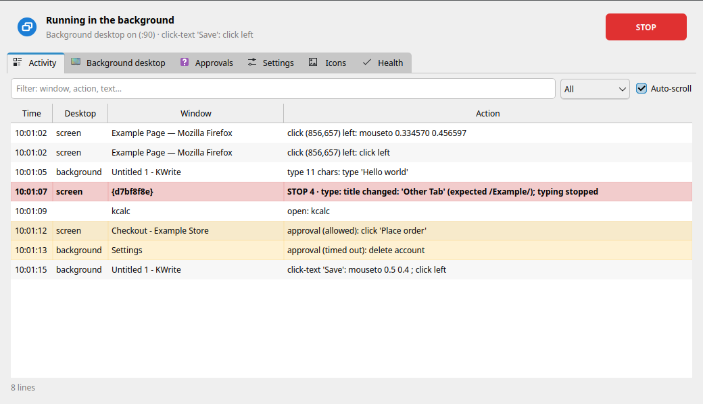
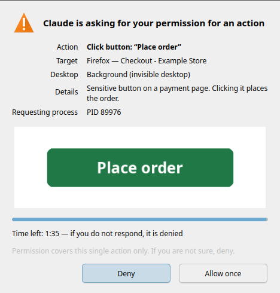
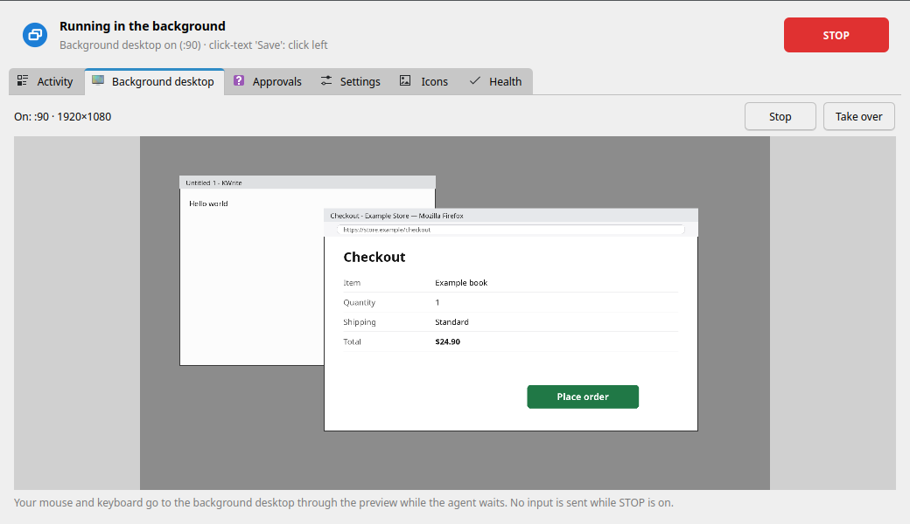

# Deskhand — yapay zekâ ajanları KDE masaüstünüzü güvenle kullansın

*English: [README.md](README.md)*

**Deskhand, yapay zekâ ajanlarının (Claude Code ve diğer MCP istemcileri) KDE Plasma
masaüstünüzü güvenle kullanmasını sağlar: ister sizin ekranınızda, ister siz film izlerken
görünmez ikinci bir masaüstünde.**

Ajan pencereleri okuyabilir, ekranda gördüğü yazıya tıklayabilir, yazı yazabilir, uygulama
açabilir. Her girdi, o anda ekranda gerçekten ne olduğuna bakılarak denetlenir. Satın al/Öde
düğmeleri ve ödeme sayfaları, ajanın erişemediği bir pencerede **sizin** yanıtınızı bekler.
Fareye dokunduğunuz an durur; tek tıkla **DUR** her şeyi keser. Meşgulseniz iş, giriş
yapılmış bazı oturumlarınızı kullanabilen gizli bir masaüstüne taşınır; filminiz ya da
oyununuz bölünmez.

İyi niyetli ajanlar için bir güvenlik katmanıdır, kum havuzu (sandbox) değildir
(bkz. [Tehdit modeli](#tehdit-modeli)).

<p align="center">
  
  
</p>
<p align="center">
  
  
</p>

<sub>Ekran görüntüleri örnek verilerle üretildi.</sub>

## Özellikler

### Güvenlik katmanları

Ajan ya da izin kipi ne derse desin, iki masaüstünde de aracın kendisi uygular:

- **Yasak pencereler.** Başlığı ya da sınıfı `~/.config/deskhand/yasak-pencereler.txt`
  içindeki bir desene uyan pencerelere hiçbir girdi gitmez, uygulamaları başlatılmaz
  (örneğin otomasyonu kurallarıyla yasaklayan çevrim içi bir oyun ya da parola yöneticisi).
  MCP üzerinden ekran görüntüsünde siyah kutu olurlar, OCR'a da girmezler.
- **Hassas düğmeler ve ödeme sayfaları insana sorulur.** Satın al, Öde, Siparişi onayla,
  Yetkilendir, İzin ver, Hesabı sil (Türkçe ve İngilizce karşılıklarıyla) ve başlığı
  ödeme/sipariş sayfasına benzeyen bir sayfadaki her tıklama ya da Enter, **Deskhand
  panelinde bir onay diyaloğu** açar: hedefin küçük bir görüntüsüyle *Bir kez izin ver* ya da
  *Reddet*. Yanıtı yalnız panel yazar; diyaloğun kendisi de yasak penceredir, ajan ona
  tıklayamaz. Yanıt yoksa, süre dolarsa ya da panel kapalıysa cevap: red.
- **Pencere/sekme başlığı kilidi.** `-b DESEN` (CLI) ya da pencere deseni (MCP) verilince
  başlık her girdiden hemen önce yeniden denetlenir. Tarayıcı sekme değiştirirse yazı
  kelimenin ortasında kesilir.
- **İnsan önceliği.** Fareyi ya da klavyeyi kullanıyorsanız (Wayland boşta bildirimi, ek
  yetki gerekmez) Deskhand 1,5 sn sessizlik bekler, en çok 8 sn; olmazsa vazgeçer. Basılı
  tuttuğu tuşları, siz herhangi bir şeye dokunduğunuz an bırakır.
- **DUR anahtarı.** Paneldeki düğme, tepsi menüsü ya da isteğe bağlı genel kısayol. Açıkken
  hiçbir girdi gönderilmez, basılı tuşlar bırakılır. Ajan da DUR diyebilir, ama **sizin
  koyduğunuz DUR'u kaldıramaz**; onu yalnız panel kaldırır.
- **Etkinlik günlüğü.** Her girdi günlüğe yazılır (`~/.local/state/deskhand`, 7 gün) ve
  panelde canlı görünür.

### Arka plan masaüstü

`deskhand desktop start` görünmez bir masaüstü açar: Xvfb + openbox, varsayılan
1920×1080, sizin oturumunuzdan ayrı.

- **Size hiçbir şey ulaşmaz.** Ekranınıza girdi gitmez (arka plan arka ucu yalnız kendi X
  ekranıyla konuşabilir). Oradaki uygulamaların D-Bus'ı ayrıdır: bildirimleri ekranınıza
  düşmez, günlüğe yakalanır; sesleri sessiz bir çıkışa gider. Wayland değişkenleri
  silinir, böylece bir uygulama ekranınıza kaçamaz.
- **Hafif.** Düşük işlemci/disk önceliği ve bellek sınırı (systemd kapsamı, varsayılan
  4 GB). Açılışı yaklaşık 0,2 sn sürer; boş masaüstü ~30 MiB kullanır.
- **Uygulama başına oturum politikası.** Bazı uygulamalar orada girişli açılabilir:
  - **Firefox:** profilinizin tutarlı, **tek yönlü anlık kopyası** (çerezler, girişler,
    görev sitelerinin deposu). Kopyadan asıl profile hiçbir şey geri yazılmaz. Sync kimliği alınmaz;
    banka/ödeme/devlet sitelerinin (Türk bankaları ve e-Devlet dahil) ve merkezi giriş sayfalarının
    (Google, Microsoft) çerezleri **ve kayıtlı şifreleri** kopyalanmaz; bu yüzden orada Google/YouTube
    oturumu açık gelmez. Kamera, mikrofon, konum ve bildirim izinleri kopyadan silinir.
  - **Şifre deposu kullanmayan Flatpak uygulamaları** (örneğin Discord, Spotify): anlık kopya.
  - **Şifre deposu isteyen uygulamalar** (Chromium ailesi, VS Code) ve gerçek dosyalara
    yazan uygulamalar (Obsidian kasaları) **yalnız sizin ekranınızda** çalışır.
  - **İki istemciyle bozulan uygulamalar** (Telegram, Signal, WhatsApp sarmalayıcıları,
    Element, Steam, Thunderbird vb.) **asla kopyalanmaz** ve arka planda hiç başlatılmaz;
    ajana sizi beklemesi söylenir. Posta/eşitleme servisleri (KMail/Akonadi, Nextcloud)
    de başlatılmaz.
  - Politika çözülmüş uygulamaya (masaüstü girdisi, çalıştırılabilir dosya, Flatpak kimliği) göre
    uygulanır; başka bir ad ya da yol vererek atlatılamaz, en kısıtlayıcı eşleşme geçerlidir. Şifre
    yöneticileri hiç başlatılmaz.
  - Bilinmeyen uygulama yalnız sizde **kesinlikle açık değilse** normal açılır (açıksa tek örnek kilidi
    pencereyi sizin ekranınıza devredebilir); bilinemiyorsa ajan bekler. Politika dosyası:
    `~/.config/deskhand/oturum.toml`.
- **İzleyin, devralın.** Panelde canlı önizleme var. *Devral* farenizi ve klavyenizi arka
  plan masaüstüne yönlendirir, bu sırada ajan bekler.

### Meşgul algısı: "Arka planda / Ekranımda / Sonra"

`deskhand busy` meşgul olup olmadığınıza yalnız okuyarak bakar: tam ekran pencere, çalan
bir medya oynatıcı (MPRIS), son klavye/fare girdisi, oyun ya da yasak pencere, kilitli ekran.

`deskhand decide "görev özeti"` bunu karara çevirir. Meşgul değilseniz cevap *ekranımda*.
Meşgulseniz varsayılan olarak bir bildirim sorar: **Arka planda yap / Ekranımda yap / Sonra**
(45 sn yanıt yoksa arka plan). Tam ekran film ya da oyun açıkken sizi hiç bölmez, doğrudan
arka plana gider. Hepsi panelden ayarlanır.

### Yazıya tıklama (önce OCR)

Ajanlar tahmin edilen koordinatlara değil, **okuyabildikleri şeye** tıklar:
`click-text <pencere> "Kaydet"`. Tesseract Türkçe ve İngilizce okur. Türkçe harfler esnek
eşleşir (ş/s, ı/i…); birden çok eşleşme varsa tahmin etmez, durur. Ayrıca: erişilebilirlik
ağacı (AT-SPI, düğmeye adıyla tıklama), kayıtlı simgeler, renk alanları ve tekrarlı işler
için ekran tanıma *akışları*.

### MCP sunucusu (12 araç)

`deskhand mcp` stdio MCP sunucusudur: `get_status`, `choose_desktop`, `manage_desktop`,
`screenshot`, `read_text`, `find`, `click`, `type_text`, `press_key`, `scroll`, `open_app`,
`run_flow`. Ekran görüntüleri uzun kenarı 1280 piksele küçültülür. Koordinatlar bir
`shot_id`'ye bağlıdır; bayat görüntüye göre tıklama reddedilir. MCP yüzeyinde "onaylandı"
bayrağı yoktur: hassas eylemler her zaman panelden geçer.

### İzleme paneli ve tepsi

Etkinlik (canlı günlük, süzgeç), arka plan ekranı (önizleme, durdurma, devralma), onaylar
(bekleyenler + geçmiş), ayarlar (meşgulken davranış, yasak pencereler, DUR kısayolu),
kayıtlı simgeler ve tüm bağımlılıkların sağlık denetimi. Tepsi simgesi boşta / ekranınızda /
arka planda / DUR durumunu gösterir; onay bekliyorsa rozet çıkar.

## Benzerleriyle karşılaştırma

Bu alanda iyi projeler var; size uyanı seçin.

- [agent-sh/agent-workspace-linux](https://github.com/agent-sh/agent-workspace-linux) en
  yakını: altı arka uçta gizli masaüstü (yerel KWin Wayland sanal kompozitörü dahil),
  anahtarlık ve Chrome profili aktarımı, uygulama izin listesi, canlı izleyici, 82 araç.
  Deskhand'den daha geniş kapsamlı ve daha taşınabilir.
- [ahmetadakli/kde-desktop-mcp](https://github.com/ahmetadakli/kde-desktop-mcp) KDE'de en
  yakın güvenlik modeline sahip: seviyeli uygulama izin listesi, onay listesi, parola alanı
  koruması, kullanıcı devralınca duraklama, durdurma kısayolu. Erişilebilirlik ağacıyla çalışır.
- [agent-sh/computer-use-linux](https://github.com/agent-sh/computer-use-linux) (önce GNOME,
  çok arka uç), [Samthesurf/kwin-mcp](https://github.com/Samthesurf/kwin-mcp) (KDE Wayland),
  [alex-oleshkevich/wayland-mcp](https://github.com/alex-oleshkevich/wayland-mcp)
  (niri/wlroots, iç içe kum havuzu, yerel OCR) diğer seçenekler.

Deskhand'in bir araya getirdikleri (başka yerde bir arada görmediklerimiz):

1. **Ekranda ne olduğuna göre denetim**, yalnız hangi uygulama olduğuna göre değil: yasak
   pencereler, hassas düğmeler, ödeme sayfası algısı, başlık/sınıf kilidi.
2. **Meşgul algısı** ve *Arka planda / Ekranımda / Sonra* döngüsü.
3. Arka plan masaüstü için **uygulama başına oturum politikası** (kopya / bekle / asla),
   iki kez çalışmaması gereken uygulamalar dahil.
4. **Türkçe OCR ile görünen yazıya tıklama**, erişilebilirlik ağacı olmayan yerde de.
5. **Plasma paneli**: tepsi, DUR, canlı önizleme, devralma, yalnız insanın verebildiği onaylar.

Kapsamı da daha dar: yalnız KDE Plasma, tek arka plan masaüstü, orada GPU yok.

## Gereksinimler

- Ön plan (kendi ekranınız) için **Wayland üzerinde KDE Plasma 6**. Arka plan masaüstü bir
  X sunucusudur (Xvfb); **X11** desteği olan uygulamaları çalıştırır (çoğunda var).
- Python **3.11+**
- Ön plan: `kdotool`, `dotool`, `spectacle`, `/dev/uinput` erişimi
- İkisi de: Türkçe ve İngilizce verisiyle `tesseract`
- Arka plan: `Xvfb`, `openbox`, `python-xlib`; önerilen `xdotool`, `pactl` (sessiz ses
  çıkışı; yoksa arka plan uygulamalarının sesi tamamen kesilir), `systemd-run` (bellek sınırı)
- Python modülleri: PyQt6, python-xlib, numpy, scipy, pillow, jeepney, mcp ≥ 2.3
- Küçük klavye etkinliği yardımcısını derlemek için: C derleyicisi, `make`, `pkg-config`,
  `wayland` (yoksa insan önceliği yalnız fareye bakar)
- Ekran görüntüsü yardımcısını derlemek için (KWin'in ekran görüntüsü arayüzü, görüntü başına
  ~8 ms): aynı araçlar ve `libsystemd` (systemd'nin parçası). `install.sh` derler ve masaüstü
  girdisini kaydeder

Arch / CachyOS:

```bash
sudo pacman -S --needed spectacle tesseract tesseract-data-tur tesseract-data-eng \
    xorg-server-xvfb openbox xdotool libpulse python-pyqt6 python-xlib python-numpy \
    python-scipy python-pillow python-jeepney python-mcp base-devel wayland
paru -S kdotool-bin dotool        # AUR (ya da yay, ya da elle)
```

`dotool`'un `/dev/uinput`'a yazabilmesi gerekir. Paketi `input` grubu için bir udev kuralı
kurar; yani:

```bash
sudo usermod -aG input "$USER"                        # sonra oturumu kapatıp açın
sudo modprobe uinput                                  # /dev/uinput yoksa
echo uinput | sudo tee /etc/modules-load.d/uinput.conf   # açılışta yüklensin
```

> **CachyOS (Arch) + KDE Plasma 6** üzerinde geliştirildi ve denendi. Diğer dağıtımlarda
> karşılık gelen paketlerle çalışması beklenir ama denenmedi.

## Kurulum

İstediğiniz yere klonlayın, kurulumu normal kullanıcınızla çalıştırın (`sudo` olmadan):

```bash
git clone https://github.com/sobelendimm/deskhand.git ~/.local/src/deskhand
cd ~/.local/src/deskhand
./install.sh --dry-run    # ne yapacağını görün
./install.sh              # kur (tekrar çalıştırmak güvenli)
```

Kurulum **paket kurmaz**: eksikleri listeler, komutu yazdırır. Sonra etkinlik yardımcısını
derler ve şunları kurar:

- `~/.local/bin` içine `deskhand` komutu (bu klasörü gösterir; klasörü taşırsanız
  `./install.sh`'i yeniden çalıştırın),
- menü girdisi ve simge,
- oturum açılışında panel (yalnız tepsi); onaylar için panelin açık olması gerekir
  (istemiyorsanız `./install.sh --no-autostart`).

Sistem geneline hiçbir şey kurulmaz. Güncelleme: `git pull && ./install.sh`. Kaldırma:
`./uninstall.sh` (ayarlar, kayıtlı simgeler ve akışlar kalır) ya da `./uninstall.sh --purge`.

## Hızlı başlangıç

```bash
deskhand panel                          # izleme paneli + tepsi
deskhand busy                           # meşgul müyüm? (yalnız okur)
deskhand windows firefox                # pencere bul: kimlik | başlık | konum
deskhand read firefox                   # penceredeki yazıları koordinatlarıyla oku (OCR)
deskhand -b "Örnek" click-text firefox "Giriş yap"     # görünen yazıya tıkla, başlık kilitli
deskhand --background open firefox --site github.com   # görünmez masaüstünde girişli Firefox
deskhand stop                           # DUR: bundan sonra girdi yok
deskhand resume                         # komut satırından konan DUR'u kaldır
```

Komutlar (`deskhand help` hepsini gösterir; Türkçe adlar da çalışır, parantez içinde):

| Komut | Ne yapar |
|---|---|
| `windows` (`bul`) `<desen>` | pencere bul |
| `screenshot` (`foto`) `<pencere>` | ekran görüntüsü (pencere ya da `ekran` = tüm ekran) |
| `read` (`metin`) `<pencere> [desen]` | yazıları + koordinatları oku (OCR) |
| `click-text` (`metne-tikla`) `<pencere> <yazı>` | görünen yazıya tıkla |
| `click` (`tikla`) `<pencere> <x> <y>` | pencere koordinatına tıkla |
| `type` (`yaz`) `<pencere> <metin>` | yaz (`--secret`: günlüğe yazılmaz) |
| `key` (`tus`) `<pencere> <tuşlar>` | tuş ya da kısayol, ör. `ctrl+s` |
| `scroll` (`kaydir`) `<pencere> [down\|up]` | kaydır |
| `wait` (`bekle`) `<pencere> <yazı>` | yazı görünene dek bekle (`--gone`: kaybolana dek) |
| `open` (`ac`) `<uygulama>` / `open --command "KOMUT"` | uygulamayı aç, yeni penceresini bekle |
| `tree` (`agac`) / `click-element` (`ogeye-tikla`) | erişilebilirlik ağacı / ögeye adıyla tıkla |
| `desktop` (`masaustu`) `start\|stop\|status` | arka plan masaüstü |
| `sessions` (`oturum`) `status\|policy\|clear` | arka planda hangi uygulama girişli açılır |
| `busy` (`mesgul`) · `decide` (`karar`) `"<iş>"` | meşgul mü · nerede çalışılsın |
| `stop` · `resume` · `status` (`dur` · `devam` · `durum`) | DUR aç · kaldır · göster |
| `panel [--tepsi]` · `mcp` | panel (yalnız tepsi) · MCP sunucusu |

Sık seçenekler: `-b/--title DESEN` başlık kilidi, `-s/--class DESEN` sınıf kilidi, `--background`
görünmez masaüstünde çalış, `--on-my-screen` oyun ya da film sırasında bile ekranınızda çalış (yalnız siz
söylediyseniz). Türkçe seçenek adları (`--baslik`, `--arka`, `--ekranimda`…) ve eski `ekran` komutu da çalışır.

## Claude Code ile (MCP)

İki girdiyi **kullanıcı** kapsamında kaydedin (`project` kapsamını kullanmayın: masaüstü
denetimi bir depoyla birlikte dolaşmamalı). Claude Code izin kuralları araç parametrelerine
bakamadığı için masaüstü ayrımı sunucu adıyla yapılır:

```bash
claude mcp add --scope user --transport stdio deskhand    -- ~/.local/bin/deskhand mcp
claude mcp add --scope user --transport stdio deskhand-bg -- ~/.local/bin/deskhand mcp --desktop background
claude mcp get deskhand        # oturum içinde: /mcp
```

| Ad | Neye dokunabilir | Önerilen izin |
|---|---|---|
| `deskhand` | ekranınız ve arka plan masaüstü (varsayılan `desktop=auto`) | `ask` |
| `deskhand-bg` | **yalnız** arka plan masaüstü (ön plan istekleri reddedilir) | daha rahat olabilir |

Örnek `~/.claude/settings.json`:

```json
{
  "permissions": {
    "allow": ["mcp__deskhand__get_status", "mcp__deskhand__read_text", "mcp__deskhand__find",
              "mcp__deskhand-bg__get_status", "mcp__deskhand-bg__read_text", "mcp__deskhand-bg__screenshot"],
    "ask":   ["mcp__deskhand__screenshot", "mcp__deskhand__click", "mcp__deskhand__type_text",
              "mcp__deskhand__press_key", "mcp__deskhand__scroll", "mcp__deskhand__open_app",
              "mcp__deskhand__run_flow", "mcp__deskhand__manage_desktop"]
  }
}
```

İzin istemleri ikinci katmandır; Deskhand'in kendi denetimleri her izin kipinde çalışır.
Ön plan için sunucunun `WAYLAND_DISPLAY`, `DBUS_SESSION_BUS_ADDRESS` ve `XDG_RUNTIME_DIR`
değişkenlerine ihtiyacı var; istemciniz onu boş bir ortamla başlatıyorsa `--env` ile verin.

Tipik bir oturum: `get_status` → (meşgul mü?) `choose_desktop` → `manage_desktop start` →
`open_app` → `read_text` → `click(text="Kaydet", verify=true)` → `type_text` → doğrulamak
için `read_text` → `manage_desktop stop`.

## Ajanlar için kullanım kalıbı (CLI)

Önce sorun, sonra her komutu seçilen masaüstünde çalıştırın:

```bash
deskhand decide "Faturayı PDF olarak kaydet"
case $? in
    0)  NEREDE="" ;;          # ekranımda
    20) NEREDE="--background" ;;    # arka plan masaüstü
    21) exit 0 ;;             # sonra: kullanıcıya söyle, şimdi bir şey yapma
esac
deskhand $NEREDE open --command "okular ~/fatura.pdf"
```

Ajanlar için kurallar: 10, 12, 13, 15 ve 16 çıkış kodlarında durun ve kullanıcıya söyleyin;
tıklamadan önce okuyun, sonra doğrulayın; `--approved`'ı yalnız kullanıcı o adımı sohbette
açıkça onayladıysa verin. Verilmezse Deskhand kullanıcıya panelden sorar.

## Yapılandırma

| Yol | İçerik |
|---|---|
| `~/.config/deskhand/yasak-pencereler.txt` | yasak pencereler (satır başına regex; başlık ya da sınıf) |
| `~/.config/deskhand/ayarlar.toml` | meşgulken davranış (`[karar]`: sor / arka / bekle, süre, tam ekranda da sor) |
| `~/.config/deskhand/oturum.toml` | arka plan için uygulama başına oturum politikası (varsayılanların üstüne birleşir) |
| `~/.local/share/deskhand/` | kayıtlı simgeler (`simgeler/`), akışlar (`akislar/`) |
| `~/.local/state/deskhand/` | girdi günlüğü (7 gün), yakalanan arka plan bildirimleri |
| `~/.cache/deskhand/` | ekran görüntüleri, OCR önbelleği (5 gün) |
| `$XDG_RUNTIME_DIR/deskhand/` | DUR anahtarı, onay istekleri, arka plan masaüstü durumu, oturum kopyaları (tmpfs, 0700) |

Her klasör `DESKHAND_CONFIG_DIR`, `DESKHAND_STATE_DIR`, `DESKHAND_CACHE_DIR`,
`DESKHAND_DATA_DIR`, `DESKHAND_RUNTIME_DIR` ile taşınabilir. Diğer değişkenler:
`DESKHAND_HEDEF=on|arka|oto` (varsayılan masaüstü), `DESKHAND_SANAL_BOYUT=1920x1080`
(arka plan boyutu), `DESKHAND_SANAL_BELLEK=4G` (bellek sınırı, `0` = kapalı).

## Çıkış kodları

| Kod | Anlamı |
|---|---|
| 0 | tamam |
| 1 | kullanım hatası |
| 2 | nokta pencere/ekran dışında |
| 3 | pencere etkin değil / önde başka pencere var |
| 4 | başlık ya da sınıf kilidi uymadı |
| 5 | birden çok eşleşme (`--sira N` verin) |
| 6 | yazı bulunamadı |
| 7 | zaman aşımı |
| 8 | pencere yok ya da taşındı |
| 9 | gerekli bir araç çalışmadı (dotool, tesseract, Xvfb…) |
| 10 | yasak pencere ya da onaysız hassas eylem |
| 11 | akış bir hata ekranına geldi |
| 12 | bilgisayarı siz kullanıyorsunuz (insan önceliği) |
| 13 | DUR açık |
| 14 | arka plan masaüstü kullanılamıyor |
| 15 | oyun oynuyor ya da film izliyorsunuz: ekranınıza dokunulmaz |
| 16 | uygulama görünmez masaüstünde açılamaz (ekranınızda açık ya da şifre deposu istiyor) |
| 20 / 21 | `decide`: arka plan / sonra (0 = ekranınız) |

MCP'de aynı kodlar `[kod] ad: ayrıntı` biçiminde hata olarak döner.

## Bilinen sınırlar

- **Tek başına duran web düğmesi** tam `read` listesinde görünmeyebilir; yazısını aramak
  (`read <pencere> "<yazı>"`, `click-text`) yedek okumaları kullanır ve bulur.
- **Arka plan masaüstünde GPU yok.** Xvfb yazılımla çizer: WebGL, oyunlar ve video çözme
  orada yavaştır.
- **Yalnız Wayland destekleyen uygulamalar arka planda çalışmaz** (orası X11).
- **Şifre deposu isteyen uygulamalar yalnız ön planda.** Chromium ailesi tarayıcılar,
  VS Code ve sırlarını KWallet/Secret Service'te tutan her şey arka plan masaüstünde girişli
  açılmaz.
- Aynı anda **tek arka plan masaüstü**.
- **Xvfb'nin henüz kimlik çerezi yok.** Yalnız yerel sokette dinler ama makinedeki başka bir
  kullanıcı bağlanabilir. `-auth` çerezi planlandı.
- **OCR yanlış okuyabilir.** Belirsiz eşleşmede tahmin etmez, durur; tıklamalar
  doğrulanabilir. Yine de küçük ya da düşük kontrastlı yazı yanlış okunabilir ya da
  bulunamayabilir.
- **Onaylar için panelin açık olması gerekir.** Kapalıysa her hassas eylem reddedilir.
- **Ön plan, Wayland üzerinde Plasma 6 ister** (kdotool + KWin betikleri).
- Etkinlik günlüğü Türkçe yazılır (panel çevirerek gösterir); mesajlar, yardım ve panel sistem dilinizi (Türkçe ya da
  İngilizce) ya da Ayarlar'daki seçimi izler.

### Tehdit modeli

Deskhand sizi ajanın **hatalarından** ve **istem enjeksiyonundan** (ajana bir şey satın
almasını ya da hesap silmesini söyleyen bir web sayfası ya da belge) korur: ajanın kendi
isteğini onaylayan ya da sizin DUR'unuzu kaldıran hiçbir aracı veya komutu yoktur.
**Kum havuzu değildir**: sizin kullanıcınızla istediği kabuk komutunu çalıştırabilen bir ajan
dosyaları değiştirebilir, paneli kapatabilir ya da masaüstünü Deskhand olmadan sürebilir.
Kabuk erişimini istemcinizin izin istemlerinin arkasında tutun.

## Geliştirme

```bash
for t in tests/test_*.py; do python3 "$t" || break; done
```

`test_mantik`, `test_ocr`, `test_onay`, `test_oturum`, `test_entegrasyon`, `test_mesgul`, `test_guvenlik`,
`test_i18n` ve `test_gui` (görünmez Qt) ekran istemez. `test_sanal` ve `test_mcp` kendi arka plan
masaüstlerini açar; ekranınıza hiçbir şey gitmez.

Testler tüm Deskhand klasörlerini geçici bir klasöre yönlendirir, gerçek ayarlarınıza
dokunmaz. `tests/ekranli/` altındaki takımlar **gerçek** ekranınızı kullanır; yalnız
bilgisayarı kullanmıyorken çalıştırın: `tests/ekranli/hepsi.sh` hepsini koşar (~15 dk; kendi geçici profilli
Firefox'unu açar, sizinkine dokunmaz; `--insansiz` onay penceresinde sizden tıklama isteyen iki adımı atlar).
Bkz. [CONTRIBUTING.md](CONTRIBUTING.md).

## Lisans

[GPL-3.0-or-later](LICENSE) © 2026 sobelendimm.
